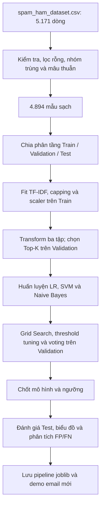

# 📧 Bài Lab Phân Loại Email Spam (Spam Email Classifier)

Bài lab **“Practice 1: Classifying Spam Emails”** thực hành phân loại email thành **Spam** (thư rác) hoặc **Ham / Not Spam** (thư hợp lệ). Mục tiêu là hiểu quy trình học máy từ kiểm tra dữ liệu, tiền xử lý, trích xuất đặc trưng đến huấn luyện, so sánh mô hình và thử dự đoán email mới.

> **Cách triển khai:** tự cài đặt các mô hình LR, Linear SVM, Naive Bayes và các chỉ số đánh giá bằng Python, NumPy/SciPy; dùng pandas để xử lý bảng và joblib để lưu model.
>
> **Kiểm chứng ngày 04/11/2026:** **57/57 tests pass**, bao gồm kiểm thử tích hợp và hồi quy. Các số liệu bên dưới được đối chiếu với kết quả của `main.py` trong `results/`. Năm Jupyter Notebooks là một luồng thực hành riêng; kết quả của chúng không được dùng thay cho kết quả chính trong README.
>
> **Kết quả chính:** Linear SVM, Test Accuracy **96,52%**, Recall **95,21%**, F1 **94,24%** trên 489 mẫu Test. Đây là kết quả trong phạm vi dataset của bài lab, chưa phải đánh giá trên hộp thư thực tế.

---

## 1. Mô Tả Bài Toán & Dữ Liệu (Problem & Data)

### 1.1. Mục tiêu phân loại

Với đầu vào là nội dung một email, chương trình trích xuất đặc trưng số và dự đoán một trong hai nhãn:

| Nhãn văn bản | Nhãn số | Ý nghĩa                                                                  |
| --------------- | --------: | -------------------------------------------------------------------------- |
| `ham`         |     `0` | Email hợp lệ, trao đổi công việc hoặc thông điệp thông thường |
| `spam`        |     `1` | Thư rác, quảng cáo hoặc nội dung có dấu hiệu spam                 |

Đây là bài toán **phân loại nhị phân có giám sát**. Nhãn số được tạo khi chuẩn bị dữ liệu cho mô hình; dữ liệu sau làm sạch vẫn giữ nhãn chuỗi `ham`/`spam` để đối chiếu.

### 1.2. Nạp dữ liệu & chuẩn hóa schema

Dataset được lấy từ [Spam Mails Dataset của venky73 trên Kaggle](https://www.kaggle.com/datasets/venky73/spam-mails-dataset), lưu tại [`data/raw/spam_ham_dataset.csv`](data/raw/spam_ham_dataset.csv). Loader ưu tiên tên file này và hỗ trợ `spam.csv` làm tên dự phòng. Hàm `load_raw_data()` trong [`src/data/loader.py`](src/data/loader.py):

- Thử đọc bằng `utf-8-sig`, sau đó dùng `latin-1` nếu gặp lỗi giải mã.
- Nhận các tên cột nhãn `label`, `category`, `v1`; cột nội dung `text`, `message`, `v2`, `body`.
- Đưa dữ liệu về các trường `source_id`, `label`, `text`, `raw_text`.
- Giữ nội dung gốc trong `raw_text`; dùng `source_id` để theo dõi bản ghi và thứ tự hàng.
- Báo lỗi khi CSV thiếu cột bắt buộc, trùng tên cột sau chuẩn hóa hoặc sai số trường. Đường dẫn tùy chỉnh không tồn tại cũng được báo lỗi.

File hiện tại có **5.171 mẫu**, gồm **3.672 ham** và **1.499 spam**. Các cột gồm một cột index không tên, `label`, `text` và `label_num`. Nội dung `text` bắt đầu bằng `Subject:`; tiêu đề nằm trong văn bản chung, chưa được tách thành feature riêng. Loader dùng `label` và `text`, không đưa index hay `label_num` vào features. Bài lab chưa khai thác sender/recipient thành các trường riêng.

### 1.3. Kiểm toán chất lượng dữ liệu (Data Quality Audit)

Kết quả dưới đây lấy từ [`results/metrics/data_audit.json`](results/metrics/data_audit.json):

| Hạng mục kiểm toán                              |       Số dòng |
| --------------------------------------------------- | --------------: |
| Dữ liệu thô đọc được                        | **5.171** |
| Loại do nhãn không hợp lệ                      |               0 |
| Loại do nội dung rỗng sau bước kiểm tra nhãn |               0 |
| Loại do nội dung mâu thuẫn nhãn — 0 nhóm     |               0 |
| Loại bản lặp cùng nội dung, cùng nhãn        |             277 |
| **Dữ liệu giữ lại sau làm sạch**        | **4.894** |

Các nhóm loại trừ được tính **không chồng lặp**: kiểm tra nhãn trước, nội dung rỗng sau, rồi mới xét nhóm trùng/mâu thuẫn. Tổng số dòng bị loại cộng số dòng giữ lại bằng số dòng đầu vào.

`clean_email_split()` tạo khóa nội dung bằng chuẩn hóa Unicode NFKC và khoảng trắng, đồng thời giữ hoa/thường và dấu câu. Nhóm cùng nội dung, cùng nhãn giữ bản đầu tiên; nhóm cùng nội dung nhưng khác nhãn bị loại toàn bộ thay vì tự chọn nhãn theo đa số.

### 1.4. Phân bố nhãn & chia tập phân tầng

Sau làm sạch, dữ liệu gồm **3.432 Ham (~70,13%)** và **1.462 Spam (~29,87%)**.

| Tập dữ liệu | Tỷ lệ cấu hình |  Tổng số mẫu |   Ham |  Spam | Vai trò                                             |
| -------------- | -----------------: | --------------: | ----: | ----: | ---------------------------------------------------- |
| Train          |                80% | **3.916** | 2.746 | 1.170 | Fit đặc trưng và huấn luyện mô hình          |
| Validation     |                10% |   **489** |   343 |   146 | Chọn Top-K, siêu tham số, ngưỡng và mô hình  |
| Test           |                10% |   **489** |   343 |   146 | Đánh giá các ứng viên tại ngưỡng đã chốt |

Khử trùng lặp thô (Exact Deduplication) và kiểm toán nhãn thuộc về tầng **Data Ingestion & Hygiene** tại `src/data/loader.py` (với hàm `load_and_sanitize_raw_data()`). Thao tác này bảo đảm giả thiết mẫu độc lập $i.i.d$ và triệt tiêu nguy cơ rò rỉ dữ liệu qua bản ghi lặp chéo tập (Cross-split Duplication Leakage). Sau đó, trong **ML Pipeline**, bước đầu tiên là **Phân tách dữ liệu độc lập ngay từ đầu (Early Stratified Split First)** bằng `stratified_split_dataframe()` (seed **42**) thành Train 80% (3.916 mẫu), Val 10% (489 mẫu), Test 10% (489 mẫu) trước mọi bước tiền xử lý văn bản và học tham số đặc trưng.

---

## 2. Nguyên Tắc Thiết Kế & Kiểm Soát Thực Nghiệm

### 2.1. Tự triển khai các thành phần học máy cốt lõi

Các lớp được xây dựng trong mã nguồn dự án gồm:

| Nhóm chức năng            | Thành phần chính                                                                   |
| ---------------------------- | ------------------------------------------------------------------------------------- |
| Tiền xử lý                | `SpamTextProcessor`, `clean_email_split()`                                        |
| Biểu diễn đặc trưng     | `CSRMatrixScratch`, `TfidfVectorizerScratch`, `MaxAbsScalerScratch`             |
| Ghép và chọn đặc trưng | `HybridFeatureBuilderScratch`, `ManualFeatureSelectorScratch`                     |
| Phân loại                  | `LogisticRegressionFromScratch`, `LinearSVMFromScratch`, `NaiveBayesClassifier` |
| Kết hợp và lựa chọn     | `SpamVotingEnsemble`, `ThresholdOptimizerScratch`, `ModelSelectionWorkflow`     |
| Đánh giá                  | `SpamModelEvaluator`                                                                |

Luồng tham chiếu không dùng các lớp phân loại hoặc hàm metrics có sẵn của scikit-learn. `requirements.txt` vẫn có scikit-learn; hàm phụ `build_tree_based_ensembles()` có thể tạo Random Forest/Gradient Boosting từ thư viện này, nhưng các mô hình cây đó **không tham gia kết quả tham chiếu được trình bày ở đây**.

### 2.2. Phân tách vai trò Train, Validation và Test

- **Train:** học từ vựng, IDF, ngưỡng cắt độ dài, tham số scaler, điểm xếp hạng đặc trưng và trọng số mô hình.
- **Validation:** so sánh số lượng đặc trưng, cấu hình huấn luyện, ngưỡng phân loại và các ứng viên mô hình.
- **Test:** giữ nguyên mô hình/ngưỡng đã chọn để tính chỉ số báo cáo và phân tích FP/FN.

EDA trên toàn bộ dữ liệu chỉ phục vụ mô tả. Các thống kê dùng để biến đổi dữ liệu được fit trên Train; Validation/Test chỉ đi qua `transform()` của bộ biến đổi đã fit.

### 2.3. Recall mục tiêu là cấu hình của dự án

Bài lab đặt `RECALL_TARGET = 0.85` để thực hành lựa chọn mô hình theo mục tiêu Recall. Đây là cấu hình của thí nghiệm, không phải ngưỡng bắt buộc trong đề bài. Khi đọc kết quả, cần xem cả Precision và số email ham bị đoán nhầm.

Khi chọn mô hình cuối, chương trình ưu tiên ứng viên đạt Recall mục tiêu trên Validation, sau đó xét Accuracy và dùng F1 khi hòa điểm. Nếu không ứng viên nào đạt mục tiêu, thứ tự ưu tiên là Recall rồi Accuracy/F1. F1 và F2 vẫn được báo cáo để thấy sự đánh đổi giữa bắt spam và chặn nhầm.

### 2.4. Tái sử dụng đúng pipeline khi suy luận

File joblib lưu mô hình cùng bộ biến đổi và thứ tự cột đã chọn. Email mới được xử lý bằng các thành phần này, thay vì fit lại TF-IDF hoặc scaler trên đầu vào mới. Ma trận thưa CSR giúp hạn chế việc tạo mảng đặc lớn; mức sử dụng RAM thực tế phụ thuộc dữ liệu và cấu hình.

---

## 3. Tiền Xử Lý & Biểu Diễn Đặc Trưng (Preprocessing & Features)

### 3.1. Chuẩn hóa văn bản

`clean_text_basic()` và `SpamTextProcessor` thực hiện:

1. Tách văn bản khỏi các thẻ HTML được nhận diện và giải mã HTML entities.
2. Thay URL, giá trị tiền tệ và số bằng các token `urltoken`, `moneytoken`, `numbertoken`.
3. Chuẩn hóa Unicode, chuyển về chữ thường và giữ các ký tự chữ/số Unicode.
4. Loại dấu câu khỏi văn bản dùng cho mô hình và lọc danh sách stop words tiếng Anh cố định.
5. Giữ các từ phủ định như `not`, `no`, `never` vì chúng có thể thay đổi nghĩa câu.

`raw_text` được giữ để đếm dấu câu, chữ hoa và các tín hiệu cấu trúc trước khi chúng bị mất trong bước chuẩn hóa. Bộ xử lý không cần tải tài nguyên NLP ngoài. Ngưỡng cắt độ dài được học theo phân vị trên Train; trong lần chạy tham chiếu, giới hạn là **791 từ sau chuẩn hóa**.

### 3.2. TF-IDF tự triển khai

Gọi `c(t,d)` là số lần token `t` xuất hiện trong tài liệu `d`. Vectorizer dùng sublinear TF với log tự nhiên:

$$
\mathrm{TF}(t,d)=
\begin{cases}
1+\ln c(t,d), & c(t,d)>0, \\
0, & c(t,d)=0.
\end{cases}
$$

Smooth IDF được tính từ số tài liệu Train chứa token:

$$
\mathrm{IDF}(t)=\ln\left(\frac{1+N}{1+\mathrm{df}(t)}\right)+1
$$

Trong đó `N` là số tài liệu Train và `df(t)` là số tài liệu Train chứa token `t`. Đặt `v(t,d) = TF(t,d) × IDF(t)`, mỗi khối được chuẩn hóa L2:

$$
x_{t,d}=\frac{v_{t,d}}{\sqrt{\sum_j v_{j,d}^{2}}}
$$

Nếu toàn bộ vector bằng 0 thì giữ nguyên vector 0. Từ vựng được học trên Train với `min_df = 2`; token không có trong từ vựng được bỏ qua khi transform dữ liệu mới. Bigram và character n-gram được giữ dưới dạng đơn vị token riêng, kể cả khi chúng chứa khoảng trắng.

### 3.3. Năm khối đặc trưng lai

Trong lần chạy tham chiếu, mỗi email được biểu diễn bởi **4.318 đặc trưng**:

| Khối                   |      Số chiều | Nội dung                                                                                                              |
| ----------------------- | --------------: | ---------------------------------------------------------------------------------------------------------------------- |
| Word TF-IDF             |           3.000 | Từ đơn sau tiền xử lý                                                                                            |
| Word bigram TF-IDF      |             800 | Cặp từ liên tiếp                                                                                                   |
| Character n-gram TF-IDF |             500 | Chuỗi con ký tự độ dài 3–5                                                                                      |
| Keywords                |              10 | Nhóm từ `free`, `win`, `prize`, `claim`, `urgent`, `call`, `cash`, `guarantee`, `offer`, `click` |
| Numeric/structural      |               8 | URL, chữ số, ký tự đặc biệt, dấu `!`, dấu `$`, tỷ lệ chữ hoa và độ dài                             |
| **Tổng**         | **4.318** | Ghép ngang thành ma trận thưa                                                                                      |

Tám đặc trưng số được chọn trong cấu hình là `has_url`, `has_number`, `digit_count`, `special_char_count`, `exclamation_count`, `dollar_count`, `uppercase_ratio`, `model_length`. Các biến đếm được biến đổi theo cấu hình rồi co dãn bằng `MaxAbsScalerScratch`, fit trên Train. Tên mode cũ có chữ `minmax`, nhưng scaler đang sử dụng thực tế là **MaxAbs**.

Scaler kiểm tra số chiều, số cột và giá trị hữu hạn khi nhận dữ liệu. Biểu đồ độ dài dùng khoảng theo dữ liệu hiện tại, bao gồm cả email dài thay vì cố định ở 150 từ.

Hai biểu đồ EDA về tỷ lệ tín hiệu và tương quan dùng chung `URL_PATTERN` với processor: nhận liên kết bắt đầu bằng `http://`, `https://` hoặc `www.` có nội dung theo sau. Địa chỉ email hoặc domain đơn thuần không được tính là URL theo định nghĩa này.

### 3.4. Chọn đặc trưng Top-K & ablation

`ManualFeatureSelectorScratch` xếp hạng cột từ Train, sau đó thử các giá trị K trên Validation bằng Complement Naive Bayes. `selected_indices` được dùng cùng thứ tự cho Train, Validation, Test và inference.

Lần chạy hiện tại chọn **500 trong 4.318 cột**, giảm **88,42% số chiều**. Bộ chọn ưu tiên các cấu hình đạt Recall mục tiêu rồi xét điểm cân bằng giữa F1, Accuracy, mức giảm số chiều và chênh lệch Accuracy Train–Validation. Vì vậy, K được chọn không nhất thiết là K có F1 cao nhất.

Notebook 02 còn so sánh năm tổ hợp: Word TF-IDF; Word + Character frequency; Word + Character n-grams; Word + Keywords; và Hybrid. Ablation dùng cùng Complement NB và threshold 0,5 để so sánh trên Validation; bảng này không tự thay đổi nhóm đặc trưng của pipeline chính.

---

## 4. Phương Pháp Phân Loại & Toán Học Cốt Lõi

### 4.1. Logistic Regression From-Scratch

Mô hình tính điểm tuyến tính rồi đưa qua sigmoid:

$$
z_i=w^{\top}x_i+b,\qquad p_i=\sigma(z_i)=\frac{1}{1+\exp(-z_i)}
$$

Với nhãn `y_i ∈ {0,1}`, hàm mục tiêu Binary Cross-Entropy có trọng số lớp và điều chuẩn L2 là:

$$
J(w,b)=-\frac{1}{N}\sum_{i=1}^{N}a_i
\left[y_i\ln p_i+(1-y_i)\ln(1-p_i)\right]
+\frac{\lambda}{2}\sum_{j=1}^{D}w_j^2
$$

`N` là số mẫu Train, `D` là số đặc trưng, `a_i` là trọng số mẫu theo lớp; bias `b` không bị điều chuẩn. Khi dùng `class_weight="balanced"`, `a_i = N / (2 × N_{y_i})`, với `N_{y_i}` là số mẫu thuộc lớp của mẫu `i` (khi Train có đủ hai lớp). Mã nguồn tính hệ số điều chuẩn như sau:

$$
\lambda=\frac{1}{\max(10^{-5},\,C N)}
$$

Với cấu hình thực nghiệm hiện tại, công thức này tương đương `lambda = 1/(C*N)`.

Loss được tính bằng `np.logaddexp` để ổn định số học. Gradient được cập nhật bằng **spectral gradient descent kết hợp Armijo backtracking**: bước học được điều chỉnh theo độ cong và giảm nếu chưa làm loss giảm đủ.

### 4.2. Linear Support Vector Machines (SVM)

Nhãn được đổi sang `{-1, +1}`; mô hình tìm hàm điểm `wᵀx + b`. Với squared hinge, hàm mục tiêu là:

$$
J(w,b)=\frac{\lambda}{2}\sum_{j=1}^{D}w_j^2
+\frac{1}{N}\sum_{i=1}^{N}a_i
\left[\max\left(0,\,1-\widetilde{y}_i(w^{\top}x_i+b)\right)\right]^2
$$

Trong đó nhãn có dấu $\widetilde{y}_i = 2y_i - 1$ thuộc `{-1,+1}`; `a_i` và `lambda` được tính như phần Logistic Regression. Lớp hỗ trợ cả `hinge` và `squared_hinge`; pipeline tham chiếu dùng **squared hinge**, tối ưu bằng gradient descent có backtracking.

`decision_function()` trả điểm khoảng cách có dấu. `predict_proba()` đưa điểm qua sigmoid để dùng chung giao diện tuning/voting. Điểm sigmoid này **chưa được calibration**; cách triển khai hiện tại không phải Platt scaling. Vì vậy, không diễn giải giá trị 0,8 như một xác suất spam thực tế đã được hiệu chỉnh.

### 4.3. Naive Bayes — Multinomial & Complement

`NaiveBayesClassifier` hỗ trợ hai biến thể:

| Biến thể     | Cách học đặc trưng                                                           |
| -------------- | --------------------------------------------------------------------------------- |
| Multinomial NB | Tần suất đặc trưng trong từng lớp, kết hợp prior của lớp               |
| Complement NB  | Tần suất trên tập phần bù của từng lớp; dùng trong pipeline tham chiếu |

Hệ số Laplace smoothing `alpha` giúp tránh xác suất đặc trưng bằng 0. Tính điểm trên miền log và trừ điểm lớn nhất trước khi lấy mũ giúp ổn định phép chuẩn hóa trong `predict_proba()`.

### 4.4. Hyperparameter Tuning, Threshold & Ensemble

Trong `main.py`, lưới tuning hiện tại gồm:

| Mô hình           | Tham số quét               | Tham số huấn luyện giữ cố định                                           |
| ------------------- | ---------------------------- | ------------------------------------------------------------------------------- |
| Logistic Regression | `C ∈ {0.5, 1.0, 2.0}`     | `learning_rate=0.1`, `max_iter=200`, balanced class weights                 |
| Linear SVM          | `C ∈ {0.5, 1.0, 2.0}`     | `learning_rate=0.05`, `max_iter=150`, squared hinge, balanced class weights |
| Complement NB       | `alpha ∈ {0.5, 1.0, 2.0}` | `kind='complement'`                                                           |

Mỗi cấu hình được fit trên Train và tối ưu threshold trên Validation. Bộ `ThresholdOptimizerScratch` mặc định quét **200 ngưỡng từ 0,005 đến 1,0**. Ngưỡng đạt Recall mục tiêu được xếp theo Accuracy, F1, Precision rồi FPR; nếu không đạt mục tiêu, ưu tiên Recall trước.

Khi chọn siêu tham số, các cấu hình đạt Recall mục tiêu được xếp theo **Accuracy → F1**; nếu không cấu hình nào đạt, dùng **Recall → Accuracy → F1**. Việc chọn dùng thứ tự ưu tiên này, không cộng điểm Accuracy vào Recall để quyết định nhánh fallback. Tuning từ chối nhãn rỗng/không nhị phân, xác suất sai độ dài hoặc không hữu hạn/ngoài `[0,1]`, và lưới threshold rỗng hoặc không hợp lệ.

`SpamVotingEnsemble` hỗ trợ soft voting và hard voting. `main.py` thử soft voting của ba mô hình mặc định và soft voting của các mô hình đã tuning; notebook 04 thử thêm hard voting. Ensemble tham gia so sánh như các ứng viên khác, không được mặc định chọn làm mô hình cuối.

Trọng số voting phải hữu hạn, không âm và có tổng dương. Một thành viên có thể có trọng số 0 nếu các thành viên còn lại vẫn có tổng trọng số dương.

---

## 5. Quy Trình Thực Thi (Workflow 4 Giai Đoạn)



| Giai đoạn trong `main.py` | Hàm điều phối                | Kết quả chính                                                      |
| ----------------------------- | -------------------------------- | --------------------------------------------------------------------- |
| 1. Early Stratified Split & Feature Preprocessing | `step_data_preprocessing()` | Ingestion audit, Early Split 80/10/10, builder fit trên Train, ma trận và thứ tự cột |
| 2. Model training             | `step_model_training()`        | Ba baseline và ba mô hình đã tuning                              |
| 3. Evaluation & selection     | `step_evaluation_and_tuning()` | Winner chọn trên Validation, metrics Test, bảng/hình và CSV lỗi |
| 4. Deployment                 | `step_deployment_and_demo()`   | Pipeline joblib, run summary và demo năm email                      |

---

## 6. Cấu Trúc Thư Mục Dự Án (Project Structure)

```text
spam_classifier/
├── main.py                            # Điều phối pipeline tham chiếu
├── requirements.txt                   # Thư viện chạy dự án
├── README.md                          # Thuyết minh và hướng dẫn
├── data/
│   ├── raw/spam_ham_dataset.csv       # Dữ liệu đầu vào từ Kaggle
│   └── processed/                     # CSV, ma trận, nhãn và marker của notebooks
├── docs/                              # Tài liệu kỹ thuật và đặc tả dự án
│   ├── ML project_ Classifying Spam Emails.pdf  # Đề bài gốc môn học
│   ├── reports/                       # Báo cáo học thuật chi tiết (spam_classifier_lab_report.html)
│   ├── Algorithms/                    # Tài liệu chuyên sâu 4 thuật toán From-Scratch
│   └── description_for_AI_working/    # Kịch bản kỹ thuật theo 4 giai đoạn và 37 bản tiến hóa
├── notebooks/
│   ├── 01_eda.ipynb
│   ├── 02_preprocessing_and_features.ipynb
│   ├── 03_model_baseline_and_training.ipynb
│   ├── 04_tuning_and_ensemble.ipynb
│   ├── 05_error_analysis_and_deployment.ipynb
│   ├── README.md                      # Quy trình và quy tắc dùng cache
│   └── results/
│       ├── figures/
│       ├── metrics/
│       └── saved_models/
├── src/
│   ├── config.py                      # Đường dẫn, cấu hình đặc trưng và thực nghiệm
│   ├── data/
│   │   ├── loader.py                  # Đọc CSV, chuẩn hóa schema, nạp & vệ sinh dữ liệu thô (Data Hygiene)
│   │   └── preprocessing.py           # Kiểm toán toàn vẹn, chia phân tầng độc lập và tiền xử lý văn bản học máy
│   ├── features/
│   │   └── feature_engineering.py     # CSR, TF-IDF, scaler, hybrid và Top-K
│   ├── models/
│   │   ├── classifiers.py             # LR, Linear SVM và Naive Bayes
│   │   ├── ensemble.py                # Soft/Hard Voting và hàm phụ tạo mô hình cây
│   │   ├── tuning.py                  # Grid Search, threshold và model selection
│   │   └── persistence.py             # Lưu/nạp bundle bằng joblib
│   ├── evaluation/
│   │   ├── metrics.py                 # Chỉ số và kiểm tra nhất quán kết quả
│   │   ├── visualization.py           # EDA, confusion matrix, ROC/PR và so sánh
│   │   ├── experiments.py             # Thử nghiệm trên dữ liệu phát triển
│   │   └── error_analysis.py          # Trích xuất, phân tích FP/FN
│   ├── deployment/
│   │   └── predictor.py               # SpamInferenceService
│   └── utils/logger.py                # Log console/file và thời gian từng bước
├── results/                           # Đầu ra của main.py
│   ├── figures/
│   ├── metrics/
│   └── saved_models/spam_pipeline.joblib
├── logs/pipeline.log
└── tests/
    ├── test_data.py
    ├── test_features.py
    ├── test_models.py
    ├── test_evaluation.py
    ├── test_deployment.py
    ├── test_model_contracts.py         # Kiểm tra đầu vào và hành vi mô hình
    ├── test_review_regressions.py      # Kiểm thử hồi quy
    └── test_pipeline.py                # Kiểm thử tích hợp qua các giai đoạn
```

---

## 7. Ánh Xạ Yêu Cầu Đề Bài Với Phần Triển Khai

| Nội dung trong đề                     | Module triển khai                                             | Cách thực hiện                                                         |
| ---------------------------------------- | -------------------------------------------------------------- | ------------------------------------------------------------------------- |
| Làm sạch stop words, punctuation, HTML | `src/data/preprocessing.py`                                  | Chuẩn hóa và token hóa văn bản, giữ bản gốc để lấy tín hiệu |
| Chuyển văn bản sang đặc trưng số  | `src/features/feature_engineering.py`                        | TF-IDF từ, bigram, character n-gram và đặc trưng bổ sung            |
| Chia tập Train/Test                     | `src/data/preprocessing.py`                                  | Chia phân tầng 80/10/10, bổ sung Validation để lựa chọn            |
| Logistic Regression, SVM, Naive Bayes    | `src/models/classifiers.py`                                  | Cài đặt và huấn luyện cả ba phương pháp                         |
| Accuracy, Precision, Recall, F1          | `src/evaluation/metrics.py`                                  | Tự tính chỉ số, bổ sung F2, ROC-AUC và confusion matrix             |
| Phân loại email mới                   | `src/models/persistence.py`, `src/deployment/predictor.py` | Lưu/nạp pipeline, dự đoán từng email hoặc danh sách               |
| Feature Engineering                      | Notebook 02, module features                                   | Ablation năm tổ hợp và thử Top-K                                     |
| Hyperparameter Tuning                    | `src/models/tuning.py`                                       | Grid Search và chọn threshold trên Validation                          |
| Ensemble Methods                         | `src/models/ensemble.py`, notebook 04                        | Soft voting và hard voting                                               |

Sender, recipient, subject line là các **ví dụ đặc trưng** trong đề; random forest/boosting là **ví dụ ensemble**. Dự án dùng các trường hiện có trong dữ liệu và triển khai voting. PDF không đặt yêu cầu phải có web UI, Recall tối thiểu 0,85 hoặc bắt buộc tự viết thuật toán.

---

## 8. Kết Quả Thực Nghiệm Tham Chiếu (Evaluation Results)

### 8.1. Mô hình được chọn từ Validation

Kết quả trong phần này thuộc luồng **`main.py`**, lấy từ [`run_summary.json`](results/metrics/run_summary.json) và [`validation_model_selection.csv`](results/metrics/validation_model_selection.csv).

Kết quả được tạo ngày **04/11/2026**. Khi cập nhật README, **22/22 hash SHA-256** trong run summary khớp với mã nguồn và fingerprint dữ liệu khớp file raw đang dùng. Các số liệu dưới đây thuộc cùng một lần chạy.

| Thuộc tính               | Giá trị                                                                                                  |
| -------------------------- | ---------------------------------------------------------------------------------------------------------- |
| Mô hình được chọn    | **Linear SVM — cấu hình mặc định trong `main.py`**                                           |
| Tham số                   | `C=1.0`, `learning_rate=0.05`, `max_iter=150`, `loss='squared_hinge'`, `class_weight='balanced'` |
| Số đặc trưng sau Top-K | **500**                                                                                              |
| Ngưỡng phân loại       | **0,555**                                                                                            |
| Validation Accuracy        | **97,14%**                                                                                           |
| Validation Recall          | **93,84%**                                                                                           |
| Validation F1              | **95,14%**                                                                                           |

Linear SVM mặc định và bản tuned có cùng các chỉ số dùng để lựa chọn trên Validation; bản mặc định đứng trước trong thứ tự ứng viên và được giữ làm kết quả cuối. Tuning không nhất thiết đem lại mô hình tốt hơn trong mọi lần chạy.

### 8.2. Chỉ số Test tại ngưỡng đã chốt

| Chỉ số            |        Giá trị | Cách đọc                                                     |
| ------------------- | ---------------: | --------------------------------------------------------------- |
| Accuracy            | **96,52%** | Tỷ lệ dự đoán đúng trên toàn bộ Test                  |
| Precision — Spam   | **93,29%** | Trong các email bị gắn nhãn spam, bao nhiêu là spam thật |
| Recall — Spam      | **95,21%** | Trong các spam thật, bao nhiêu được phát hiện           |
| F1                  | **94,24%** | Trung bình điều hòa Precision và Recall                    |
| F2                  | **94,82%** | Cân bằng hai chỉ số với trọng số nghiêng về Recall     |
| ROC-AUC             | **99,46%** | Khả năng xếp hạng spam cao hơn ham theo điểm mô hình   |
| False-positive rate |  **2,92%** | Tỷ lệ Ham bị đánh nhầm thành Spam                        |

Ma trận nhầm lẫn có **hàng là nhãn thật, cột là nhãn dự đoán**:

| Nhãn thật \ Nhãn dự đoán |                 Ham |                Spam |
| ------------------------------ | ------------------: | ------------------: |
| Ham                            | **333 — TN** |  **10 — FP** |
| Spam                           |   **7 — FN** | **139 — TP** |

Trên 489 mẫu Test, mô hình dự đoán đúng 472 mẫu, nhầm **10/343 email ham** thành spam và bỏ sót **7/146 email spam**. Các mẫu sai được lưu để đọc và phân tích trong bài lab. ROC/PR được vẽ từ các score thực tế, xử lý các score bằng nhau theo nhóm; marker được tính tại đúng threshold đã chọn.

### 8.3. So sánh kết quả và lưu ý khi diễn giải

| Mô hình trên cùng split Test                       |         Accuracy |        Precision |           Recall |               F1 |
| ------------------------------------------------------ | ---------------: | ---------------: | ---------------: | ---------------: |
| **Linear SVM — được chọn trên Validation** | **96,52%** | **93,29%** | **95,21%** | **94,24%** |
| Logistic Regression (Tuned)                            |           96,73% |           92,21% |           97,26% |           94,67% |
| Complement Naive Bayes (Tuned)                         |           93,87% |           88,67% |           91,10% |           89,86% |
| SpamVotingEnsemble (Tuned)                             |           95,91% |           90,38% |           96,58% |           93,38% |

Bảng trích từ [`test_models_comparison.csv`](results/metrics/test_models_comparison.csv). Logistic Regression (Tuned) có Accuracy và F1 Test cao hơn một chút, nhưng mô hình cuối vẫn là Linear SVM đã chọn trên Validation; không chọn lại theo Test.

README trước đây ghi kết quả trên dataset khác. Vì dữ liệu và split đã thay đổi, không dùng mức chênh lệch giữa số liệu cũ và mới để kết luận việc sửa thuật toán làm tăng chất lượng. Muốn so sánh hai phiên bản, cần chạy chúng trên cùng dữ liệu và cùng cách chia tập.

---

## 9. Hướng Dẫn Cài Đặt & Khởi Chạy

### 9.1. Chuẩn bị môi trường

Sử dụng **Python 3.10 trở lên** và chạy lệnh từ thư mục gốc dự án. Các thư viện được khai báo trong [`requirements.txt`](requirements.txt): NumPy, pandas, SciPy, scikit-learn, joblib, Matplotlib và seaborn.

Trên Windows PowerShell, có thể tạo môi trường và gọi trực tiếp Python trong `.venv`:

```powershell
python -m venv .venv
.\.venv\Scripts\python.exe -m pip install -r requirements.txt
```

Nếu đã chọn đúng interpreter hoặc kích hoạt môi trường ảo, có thể dùng `python` thay cho đường dẫn đầy đủ trong các lệnh bên dưới.

### 9.2. Chạy pipeline tham chiếu

Đặt `spam_ham_dataset.csv` từ nguồn Kaggle ở mục 1.2 vào `data/raw/`, sau đó chạy:

```powershell
.\.venv\Scripts\python.exe main.py
```

Pipeline sẽ thực hiện bốn giai đoạn ở mục 5, ghi log, tạo bảng/biểu đồ và lưu model. Kết thúc chương trình có demo phân loại năm văn bản; các ví dụ demo không có nhãn kiểm chứng nên không dùng để tính chất lượng.

### 9.3. Chạy bộ kiểm thử

```powershell
.\.venv\Scripts\python.exe -m unittest discover -s tests -v
```

Lần kiểm chứng ngày **04/11/2026** có **57/57 tests pass**. Phạm vi gồm đọc/làm sạch dữ liệu, chia tập, TF-IDF/scaler/Top-K, mô hình, voting, threshold, metrics, lưu/nạp và inference. Các regression tests mới kiểm tra số chiều và giá trị hữu hạn của scaler, trọng số ensemble, hình dạng ROC và marker threshold, histogram email dài, cùng đường dẫn model khi chạy ngoài project root.

Kiểm thử hồi quy còn kiểm tra LR/SVM học được tín hiệu nhỏ trên ma trận thưa, tránh lặp lại lỗi hội tụ hoặc phân kỳ khi thay `C`. Tests xác nhận hành vi phần mềm; chất lượng dự đoán vẫn cần đánh giá trên dữ liệu có nhãn.

### 9.4. Dự đoán email mới bằng Python

Chạy ví dụ sau từ thư mục gốc sau khi đã có file pipeline:

```python
from src.deployment.predictor import SpamInferenceService

service = SpamInferenceService().load_service()

result = service.predict_single(
    "Dear team, please review the meeting notes before Monday."
)
print(result)

batch_results = service.predict_batch([
    "URGENT! Claim your free cash prize now!",
    "Please send the weekly project report when ready.",
])
print(batch_results[["prediction", "spam_score", "is_calibrated", "threshold_used"]])
```

Đường dẫn bundle mặc định là `SAVED_MODELS_DIR / "spam_pipeline.joblib"`, được dùng thống nhất khi lưu, nạp và tạo dịch vụ inference. Đường dẫn này được xác định từ thư mục dự án, không phụ thuộc thư mục làm việc. Python vẫn cần import được package `src`. Có thể truyền `bundle_path` để chọn model khác; đường dẫn tùy chỉnh tương đối được tính từ thư mục làm việc hiện tại.

`predict_single()` trả dictionary gồm `raw_text`, `prediction`, `is_spam`, `spam_score`, `threshold_used`, `risk_level`, `detected_signals` và metadata diễn giải điểm. `predict_batch()` trả DataFrame. Trường cũ `spam_probability` được giữ làm alias của `spam_score`; `is_calibrated=False` và `score_note` nêu rõ chưa hiệu chỉnh. `risk_level` là Cao/Thấp theo quyết định tại threshold, không phải xác suất rủi ro; xem `risk_basis`.

### 9.5. Thay đổi cấu hình thực nghiệm

[`src/config.py`](src/config.py) tập trung đường dẫn, seed, tỷ lệ chia tập, giới hạn đặc trưng, keywords, numeric features, Recall mục tiêu và `SpamExperimentConfig`. Tham số baseline cùng lưới tuning thực thi của luồng tham chiếu nằm trong `step_model_training()` ở `main.py`.

Sau khi thay cấu hình đặc trưng hoặc thuật toán, chạy lại thí nghiệm tương ứng để tạo model/metrics mới. Cập nhật số liệu trong README và báo cáo từ artifacts mới; không ghép builder mới với trọng số model cũ.

---

## 10. Năm Jupyter Notebooks & Quy Tắc Tái Lập

Các notebook dùng mã nguồn chung trong `src/` và tạo **một chuỗi thực nghiệm riêng**. Baseline và lưới tuning hiện tại đã khớp `main.py`, nhưng các ứng viên ensemble có khác nhau. Vì vậy, cần ghi rõ kết quả thuộc luồng nào khi viết báo cáo.

Các khác biệt hiện tại cần lưu ý:

| Thành phần                            | `main.py`                    | Notebooks                                                                   |
| --------------------------------------- | ------------------------------ | --------------------------------------------------------------------------- |
| EDA độ dài, tín hiệu, tương quan | Dữ liệu đã làm sạch      | Notebook 01 dùng dữ liệu thô                                            |
| Baseline LR: learning rate / số vòng  | `0.1 / 200`                  | `0.1 / 200` (đã đồng bộ)                                             |
| Baseline SVM: learning rate / số vòng | `0.05 / 150`                 | `0.05 / 150` (đã đồng bộ)                                            |
| Grid Search                             | Lưới tại mục 4.4           | Notebook 04 dùng cùng lưới C, learning rate, số vòng và alpha        |
| Ensemble                                | Soft voting baseline và tuned | Soft/hard voting trên các model tuned; hard voting giữ threshold `0.5` |

Notebook 02 dùng cùng cấu hình chia tập, hybrid builder và dải Top-K với main ở cấu hình mặc định. Notebook 05 giữ winner/ngưỡng đã chốt trên Validation trước khi đánh giá Test. Ngưỡng `0.0` của SVM trong notebook 03 áp dụng trên điểm `decision_function`, tương đương ngưỡng sigmoid `0.5`.

| Thứ tự | Notebook                                                                                      | Nội dung chính                                                              |
| -------- | --------------------------------------------------------------------------------------------- | ----------------------------------------------------------------------------- |
| 01       | [`01_eda.ipynb`](notebooks/01_eda.ipynb)                                                     | Schema, kiểm toán, nhãn, độ dài, ngoại lai, từ khóa và tương quan |
| 02       | [`02_preprocessing_and_features.ipynb`](notebooks/02_preprocessing_and_features.ipynb)       | Vệ sinh dữ liệu thô (Data Hygiene), Early Split First, tiền xử lý và fit đặc trưng trên Train |
| 03       | [`03_model_baseline_and_training.ipynb`](notebooks/03_model_baseline_and_training.ipynb)     | Huấn luyện ba baseline, đánh giá Validation và xem loss                 |
| 04       | [`04_tuning_and_ensemble.ipynb`](notebooks/04_tuning_and_ensemble.ipynb)                     | Grid Search, soft/hard voting, chọn threshold và winner trên Validation    |
| 05       | [`05_error_analysis_and_deployment.ipynb`](notebooks/05_error_analysis_and_deployment.ipynb) | Test, FP/FN, lưu/nạp, kiểm tra inference và demo                          |

Mở bằng Jupyter hoặc VS Code, chọn interpreter có các thư viện cần thiết, rồi dùng **Restart & Run All** lần lượt từ 01 đến 05 và lưu notebook. `requirements.txt` phục vụ các thư viện tính toán; môi trường notebook/kernel do Jupyter hoặc IDE cung cấp riêng.

Notebook 02 xuất CSV, ma trận sau Top-K và nhãn vào `data/processed/`, kèm marker `notebook_run_id.txt`. `feature_artifacts.joblib` giữ config, builder, thứ tự cột, `source_id`, `run_id` và hash SHA-256 của các file cache. Các notebook sau kiểm tra sự khớp nhau trước khi chạy.

Nếu cache bị thay đổi hoặc `run_id` không khớp, chạy lại từ notebook 02, tiếp tục 03 → 04 → 05. Không thay cache notebook bằng dữ liệu/model trong `results/` của `main.py`. Notebook 05 kiểm tra parity giữa cache và suy luận trên 10 mẫu Test đầu sau lưu/nạp; đây là kiểm tra theo mẫu.

Chi tiết xem [`notebooks/README.md`](notebooks/README.md).

---

## 11. Kết Quả Đầu Ra, Báo Cáo & Bàn Giao

### 11.1. Artifacts của `main.py`

| Đường dẫn trong `results/`           | Nội dung                                                                                  |
| ------------------------------------------ | ------------------------------------------------------------------------------------------ |
| `metrics/data_audit.json`                | Các nhóm chất lượng dữ liệu và thống kê từng split                              |
| `metrics/top_k_sweep.csv`                | Các cấu hình Top-K được thử trên Validation                                        |
| `metrics/validation_model_selection.csv` | Ứng viên, ngưỡng, tham số, chỉ số Validation và thứ hạng                         |
| `metrics/test_models_comparison.csv`     | Chỉ số Test tại ngưỡng riêng đã chọn trên Validation; có cờ winner             |
| `metrics/misclassified_samples.csv`      | Nội dung mẫu FP/FN và phân tích lỗi                                                  |
| `metrics/run_summary.json`               | Winner, threshold, số chiều, metrics Validation/Test và hash mã nguồn                 |
| `figures/`                               | EDA, Top-K, threshold sensitivity, confusion matrix, ROC/PR và so sánh mô hình         |
| `saved_models/spam_pipeline.joblib`      | Bundle gồm model, text processor, feature builder, cột đã chọn, threshold và metrics |

Log từng giai đoạn được ghi vào `logs/pipeline.log`. Hàm lưu pipeline dùng joblib với mức nén 3; chỉ cần nạp bundle đã tạo để dùng dịch vụ inference.

### 11.2. Artifacts của notebooks

Kết quả nằm trong `notebooks/results/`, gồm `figures/`, `metrics/`, `saved_models/`. Các bảng chính: `feature_ablation.csv`, `top_k_sweep.csv`, `baseline_validation.csv`, `hyperparameter_tuning.csv`, `validation_model_selection.csv`, `test_models_comparison.csv`, `misclassified_samples.csv`.

Model trung gian gồm `feature_artifacts.joblib`, `baseline_models.joblib` và `spam_pipeline.joblib`; mỗi bundle được dùng theo đúng thứ tự notebook và `run_id`.

---

## 12. Giới Hạn Hiện Tại & Hướng Phát Triển

| Giới hạn đã biết                                                  | Hướng phát triển phù hợp                                                                   |
| ---------------------------------------------------------------------- | ------------------------------------------------------------------------------------------------ |
| Còn **10 FP và 7 FN** trên 489 mẫu Test; FPR **2,92%** | Đọc các mẫu sai để hiểu giới hạn của mô hình và đề xuất thí nghiệm tiếp theo  |
| Một split cố định                                                  | Đánh giá độ ổn định qua nhiều seed hoặc cross-validation                               |
| Test đã được quan sát trong vòng phát triển                   | Dùng holdout mới hoặc dữ liệu ngoài để đánh giá độc lập các cải tiến tiếp theo |
| Sigmoid SVM và voting chưa được calibration                       | Thực nghiệm calibration trên dữ liệu phát triển được tách đúng vai trò             |
| Tuning nhiều lần trên cùng Validation có thể overfit             | Giới hạn việc dò tham số, dùng quy trình đánh giá phù hợp khi mở rộng thí nghiệm |
| Stop words tiếng Anh; chưa có đánh giá theo ngôn ngữ           | Bổ sung dữ liệu và quy trình riêng nếu muốn hỗ trợ tiếng Việt                        |
| Chỉ đánh giá trên một dataset email từ Kaggle                   | Thử trên nguồn email khác để xem mô hình có giữ được chất lượng hay không       |
| Chưa có metadata sender/recipient/subject riêng                     | Bổ sung khi có nguồn dữ liệu phù hợp và nhãn đáng tin cậy                            |

Lần kiểm tra này không phát hiện nhóm nội dung giống nhau nhưng khác nhãn theo khóa chuẩn hóa đang dùng. Điều đó chưa chứng minh mọi nhãn đều đúng hoặc mọi mẫu gần trùng đã được nhận diện. Khi phân tích lỗi, không đổi nhãn hay loại mẫu chỉ vì mô hình dự đoán sai.

Bài lab dừng ở việc xây dựng, đánh giá và thử sử dụng mô hình bằng Python. Kết quả giúp so sánh các phương pháp trên dataset đã chọn; chưa đủ để kết luận mô hình phù hợp cho việc lọc thư tự động ngoài thực tế.
