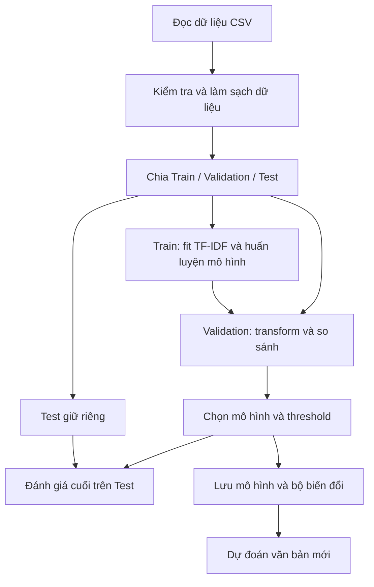

# Thiết kế bài lab Spam Classifier theo 5W1H

Trong bài lab này, em dự kiến xây dựng chương trình phân loại văn bản thành spam và ham. Mục tiêu chính là thực hành các bước của một bài toán Machine Learning: chuẩn bị dữ liệu, tạo đặc trưng, huấn luyện và đánh giá mô hình.

Tài liệu này trình bày phương án thiết kế trước khi thực hiện. Các cấu hình bên dưới là lựa chọn dự kiến cho bài lab; kết quả thực nghiệm sẽ được ghi lại trong báo cáo sau khi chạy chương trình.

## 1. What 

### Bài toán và phạm vi

Em chọn bài toán **phân loại văn bản nhị phân có giám sát**. Với nội dung một tin nhắn, chương trình cần dự đoán một trong hai nhãn:

- `ham = 0`: tin nhắn hợp lệ.
- `spam = 1`: tin nhắn rác.

Dữ liệu đầu vào dự kiến là file CSV chứa nội dung và nhãn. Bài lab sử dụng dữ liệu SMS để thực hành phân loại spam, nên kết quả chưa thể dùng để kết luận về khả năng lọc email thực tế.

Phạm vi thực hiện gồm làm sạch dữ liệu, chia tập, tạo đặc trưng, huấn luyện các mô hình đơn giản, so sánh kết quả và thử dự đoán văn bản mới. Em dự kiến chạy chương trình trên máy cá nhân, chưa xây dựng chức năng kết nối với hộp thư thật.

### Dữ liệu đầu vào và kết quả đầu ra dự kiến

| Bước                        | Đầu vào                             | Đầu ra                                                                  |
| :---------------------------- | :------------------------------------- | :------------------------------------------------------------------------ |
| Đọc và kiểm tra dữ liệu | File CSV có nội dung và nhãn       | Dữ liệu có các trường `source_id`, `raw_text`, `label`        |
| Làm sạch và chia tập      | Dữ liệu đã đọc                   | Các tập Train, Validation và Test; thống kê những dòng bị loại   |
| Tạo đặc trưng             | Nội dung văn bản                    | Ma trận đặc trưng số để đưa vào mô hình                       |
| Huấn luyện và lựa chọn   | Train và Validation                   | Mô hình cùng cấu hình và threshold được chọn                    |
| Đánh giá                   | Mô hình đã chọn và Test          | Bảng metrics, confusion matrix và một số trường hợp dự đoán sai |
| Chạy thử                    | Một văn bản mới                    | Nhãn dự đoán và score của mô hình                                 |
| Lưu kết quả                | Mô hình và bộ biến đổi đã fit | File để nạp lại và tiếp tục dự đoán                             |

## 2. Why 

Em chọn đề tài phân loại spam vì bài toán có đầu vào và đầu ra rõ ràng, phù hợp để thực hành xử lý văn bản. Qua bài lab, em muốn hiểu cách biến văn bản thành dữ liệu số và cách đánh giá mô hình ngoài việc chỉ nhìn vào Accuracy.

Em dự kiến bắt đầu từ baseline đơn giản, sau đó mới thử các mô hình khác để có cơ sở so sánh.

| Lựa chọn dự kiến                               | Lý do chọn                                                                             | Hạn chế                                              |
| :------------------------------------------------- | :--------------------------------------------------------------------------------------- | :----------------------------------------------------- |
| Word TF-IDF + Complement Naive Bayes làm baseline | Dễ triển khai, huấn luyện nhanh, phù hợp đặc trưng không âm                   | Khả năng thể hiện ngữ cảnh còn hạn chế        |
| Logistic Regression và Linear SVM                 | Phù hợp dữ liệu văn bản dạng ma trận thưa; có thể xem trọng số đặc trưng | Cần chọn tham số và kiểm tra quá trình hội tụ |
| Chia riêng Validation và Test                    | Có dữ liệu để chọn mô hình và dữ liệu để đánh giá cuối                  | Giảm số mẫu dành cho huấn luyện                  |
| Theo dõi cả Recall và Precision                 | Biết mô hình bỏ sót spam hay nhận nhầm ham ở mức nào                           | Cần cân nhắc sự đánh đổi giữa hai chỉ số    |
| Lưu mô hình cùng bộ biến đổi               | Dùng lại đúng cách tạo đặc trưng khi dự đoán                                 | Cần kiểm tra kết quả sau khi nạp lại             |

Để hiểu thuật toán, em dự kiến tự cài đặt các thành phần cốt lõi bằng Python với NumPy/SciPy. Đây là hướng thực hiện của bài lab, không phải khẳng định về yêu cầu bắt buộc của đề bài.

## 3. Who

Bài lab chủ yếu phục vụ việc học và đánh giá môn học.

| Người tham gia       | Vai trò                                                                           |
| :--------------------- | :--------------------------------------------------------------------------------- |
| Sinh viên thực hiện | Chuẩn bị dữ liệu, viết chương trình, chạy thử và giải thích kết quả |
| Giảng viên           | Xem cách thiết kế, kiểm tra phương pháp và đánh giá báo cáo           |
| Người chạy demo     | Nhập văn bản mới và quan sát dự đoán                                      |

Em chịu trách nhiệm ghi lại cấu hình, seed và kết quả để có thể chạy lại. Các metrics và quy tắc chọn mô hình sẽ được xác định trước khi huấn luyện so sánh.

## 4. When 

Em dự kiến thực hiện theo từng bước, hoàn thành baseline trước khi thử cải tiến.

| Bước | Công việc                                                               | Kết quả cần có                                 |
| :----- | :------------------------------------------------------------------------ | :------------------------------------------------- |
| 1      | Xác định phạm vi, đầu vào, đầu ra và metrics                    | Phương án thiết kế cho bài lab               |
| 2      | Kiểm tra, làm sạch và chia dữ liệu                                  | Train, Validation, Test và thống kê dữ liệu   |
| 3      | Tạo TF-IDF và huấn luyện Naive Bayes                                  | Baseline chạy được, có kết quả Validation   |
| 4      | Thử Logistic Regression, Linear SVM và một số đặc trưng bổ sung   | Bảng so sánh với baseline                       |
| 5      | Chọn mô hình và threshold bằng Validation, sau đó đánh giá Test | Kết quả đánh giá cuối và phân tích lỗi   |
| 6      | Lưu mô hình, chạy demo và viết báo cáo                            | Chương trình có thể nạp lại để dự đoán |

Nếu kết quả Test chưa tốt, em sẽ ghi rõ hạn chế trong báo cáo. Việc dùng kết quả đó để điều chỉnh mô hình sẽ cần một lần đánh giá độc lập mới.

## 5. Where 

Em dự kiến chạy bài lab trên máy cá nhân bằng Python. File `main.py` dùng để chạy các bước chính; notebook dùng để khảo sát dữ liệu và trình bày thử nghiệm.

Để dễ theo dõi, mã nguồn được chia theo công việc của từng bước:

| Vị trí                           | Nội dung chính                                          |
| :--------------------------------- | :-------------------------------------------------------- |
| `src/data/`                      | Đọc, làm sạch, chuẩn hóa văn bản và chia tập    |
| `src/features/`                  | Tạo và chọn đặc trưng; chỉ fit trên Train         |
| `src/models/`                    | Cài đặt mô hình, tuning và lưu/nạp mô hình      |
| `src/evaluation/`                | Tính metrics, vẽ biểu đồ và phân tích lỗi        |
| `src/deployment/`                | Nạp mô hình để dự đoán văn bản mới             |
| `data/raw/`, `data/processed/` | Lưu dữ liệu gốc và dữ liệu sau xử lý             |
| `results/`, `logs/`            | Lưu bảng kết quả, biểu đồ, mô hình và log chạy |

## 6. How 

### 6.1. Luồng dữ liệu dự kiến



### 6.2. Dữ liệu và chống leakage

Em dự kiến xử lý dữ liệu theo các bước sau:

1. Kiểm tra cột nội dung, cột nhãn, encoding và các dòng rỗng. Giữ `source_id` để đối chiếu với dữ liệu gốc.
2. Kiểm tra nội dung trùng trước khi chia tập. Với các dòng trùng cùng nhãn, giữ một dòng; với cùng nội dung nhưng khác nhãn, loại nhóm đó và ghi lại số lượng.
3. Chia phân tầng theo nhãn với tỷ lệ dự kiến **80% Train / 10% Validation / 10% Test**, dùng **seed 42**. Kiểm tra số mẫu mỗi lớp trước khi chốt cấu hình này.
4. Chỉ fit từ vựng, IDF, scaler và các bước chọn đặc trưng trên Train. Validation và Test dùng `transform()` với bộ biến đổi đã fit.
5. Chọn cấu hình và threshold bằng Validation. Test được giữ riêng để đánh giá sau khi đã chọn xong.

Cách làm này nhằm tránh data leakage, chẳng hạn để thông tin từ Test tham gia vào việc xây dựng từ vựng hoặc chọn mô hình.

### 6.3. Chiến lược đặc trưng và mô hình

**Baseline dự kiến:** chuẩn hóa văn bản → word unigram TF-IDF → Complement Naive Bayes.

Em chọn baseline này vì cách thực hiện tương đối đơn giản và thời gian huấn luyện thấp. Đặc trưng đưa vào Naive Bayes cần không âm. Khi cài đặt, em sẽ chú ý trường hợp từ chưa có trong từ vựng, vector rỗng và phép tính log.

Sau khi có kết quả baseline trên Validation, em dự kiến:

- Thử **Logistic Regression** và **Linear SVM** với cùng đặc trưng và cách chia dữ liệu để so sánh thuật toán.
- Thử thêm bigram, character n-gram hoặc một số đặc trưng như độ dài và số từ khóa. Thay đổi từng nhóm để xem phần nào giúp cải thiện kết quả.
- Thử một số ít cấu hình hyperparameter, ghi lại kết quả và trường hợp không hội tụ.
- Nếu còn thời gian, thử **Voting Ensemble** để xem việc kết hợp mô hình có tốt hơn mô hình đơn hay không.

Các mô hình này vẫn có thể nhầm khi văn bản quá ngắn, chứa từ mới hoặc có ngữ cảnh phức tạp. Em sẽ dựa trên kết quả Validation để quyết định lựa chọn cuối cùng.

### 6.4. Metrics và quy tắc lựa chọn trước training

Trước khi chạy so sánh, em dự kiến sử dụng các chỉ số sau:

| Chỉ số         | Ý nghĩa trong bài lab                                                |
| :--------------- | :---------------------------------------------------------------------- |
| Recall           | Tỷ lệ spam được phát hiện đúng                                 |
| Precision        | Tỷ lệ dự đoán spam thực sự là spam                              |
| Accuracy         | Tỷ lệ dự đoán đúng trên toàn bộ mẫu                          |
| F1, F2           | Kết hợp Precision và Recall; F2 đặt trọng số cao hơn cho Recall |
| FPR và số FP   | Mức độ nhận nhầm ham thành spam                                   |
| Confusion matrix | Số lượng dự đoán đúng và sai ở từng lớp                     |

Nếu cần xem thêm ảnh hưởng của threshold, em sẽ dùng ROC-AUC và PR curve. Thời gian huấn luyện và dự đoán cũng được ghi lại để so sánh chi phí giữa các mô hình.

**Quy tắc lựa chọn dự kiến trên Validation:** ưu tiên mô hình đạt `Recall >= 0.85`; trong nhóm này chọn Accuracy cao nhất, sau đó xét F1 nếu bằng nhau. Nếu không mô hình nào đạt mục tiêu, ưu tiên Recall, rồi Accuracy và F1, đồng thời báo rõ chưa đạt mục tiêu. Nếu các chỉ số vẫn bằng nhau, giữ ứng viên được xét trước theo thứ tự đã ghi trong cấu hình thử nghiệm.

Mốc `0.85` là mục tiêu thử nghiệm của bài lab. Em vẫn cần xem Precision và FPR vì tăng khả năng phát hiện spam có thể làm tăng số tin nhắn hợp lệ bị nhận nhầm.

### 6.5. Kiểm thử và nghiệm thu dự kiến

Em dự kiến kiểm tra các phần chính trước khi tổng hợp báo cáo:

- **Dữ liệu:** xử lý được dòng rỗng, nhãn sai và nội dung trùng; số dòng giữ lại và loại bỏ khớp với dữ liệu ban đầu.
- **Chia tập:** cùng seed cho cùng kết quả; nội dung trùng không xuất hiện ở nhiều tập.
- **Đặc trưng:** Validation/Test có cùng số cột và thứ tự đặc trưng với Train; `transform()` không làm thay đổi từ vựng hoặc IDF.
- **Mô hình và metrics:** dùng ví dụ nhỏ có thể tính tay để đối chiếu; kiểm tra trường hợp mẫu số bằng 0 và quá trình hội tụ.
- **Chạy toàn bộ:** thử pipeline trên tập dữ liệu nhỏ, sau đó chạy dữ liệu của bài lab và kiểm tra các file kết quả.
- **Lưu/nạp:** cùng một đầu vào cho cùng nhãn và score tương đương trong sai số số học sau khi nạp lại mô hình.

Báo cáo sẽ ghi cấu hình, seed, metrics và một số mẫu dự đoán sai. Việc chương trình chạy được và việc mô hình đạt mục tiêu chất lượng sẽ được đánh giá riêng dựa trên kết quả thực tế.

### 6.6. Các trường hợp dễ gặp lỗi và giới hạn

| Trường hợp                                             | Cách xem xét trong bài lab                                                           |
| :-------------------------------------------------------- | :-------------------------------------------------------------------------------------- |
| Spam viết biến dạng hoặc chứa từ mới               | Xem các mẫu bỏ sót và thử character n-gram                                        |
| Ham chứa từ thường gặp trong quảng cáo             | Xem các mẫu FP và sự thay đổi Precision/FPR theo threshold                        |
| Số mẫu ham và spam chênh lệch                        | Kiểm tra phân bố nhãn và đọc nhiều metrics thay vì chỉ Accuracy               |
| Tuning quá nhiều lần trên Validation                  | Giới hạn số cấu hình và ghi lại các lần thử                                   |
| Dữ liệu mới khác ngôn ngữ hoặc khác dữ liệu SMS | Ghi rõ giới hạn, cần dữ liệu phù hợp để kiểm chứng thêm                    |
| Hiểu score là xác suất chính xác                    | Ghi rõ ý nghĩa score; SVM margin qua sigmoid chưa phải xác suất đã calibration |

Khi đưa ví dụ vào báo cáo, em sẽ tránh chia sẻ nội dung có thông tin cá nhân. Với quy mô bài lab, kết quả chủ yếu phản ánh khả năng của mô hình trên tập dữ liệu đã sử dụng.

## 7. Cấu trúc dự án dự kiến

Em dự kiến tổ chức các file như sau để dễ tìm và sử dụng lại từng phần. Các file sẽ được bổ sung theo nhu cầu thực hiện bài lab.

```text
spam_classifier/
├── README.md                         # Giới thiệu và hướng dẫn chạy
├── requirements.txt                  # Các thư viện sử dụng
├── main.py                           # Chạy pipeline chính
├── data/
│   ├── raw/                          # Dữ liệu gốc
│   └── processed/                    # Dữ liệu sau xử lý
├── docs/
│   └── Algorithms/
│       ├── design.md                 # Thiết kế bài lab
│       ├── README.md                 # Giới thiệu tài liệu thuật toán
│       ├── naive_bayes.md            # Naive Bayes
│       ├── logistic_regression.md    # Logistic Regression
│       ├── linear_svm.md             # Linear SVM
│       └── voting_ensemble.md        # Thử nghiệm kết hợp mô hình
├── notebooks/                        # Khảo sát dữ liệu và trình bày thử nghiệm
├── src/
│   ├── config.py                     # Đường dẫn, seed và cấu hình
│   ├── data/
│   │   ├── loader.py                 # Đọc dữ liệu
│   │   └── preprocessing.py          # Làm sạch và chia tập
│   ├── features/
│   │   └── feature_engineering.py    # Tạo và chọn đặc trưng
│   ├── models/
│   │   ├── classifiers.py            # Cài đặt các mô hình và hàm fit()
│   │   ├── tuning.py                 # Chọn cấu hình bằng Validation
│   │   ├── ensemble.py               # Kết hợp mô hình
│   │   └── persistence.py            # Lưu và nạp mô hình
│   ├── evaluation/
│   │   ├── metrics.py                # Tính chỉ số đánh giá
│   │   ├── experiments.py            # So sánh các thử nghiệm
│   │   ├── visualization.py          # Vẽ biểu đồ
│   │   └── error_analysis.py         # Xem các dự đoán sai
│   ├── deployment/
│   │   └── predictor.py              # Dự đoán văn bản mới
│   └── utils/
│       └── logger.py                 # Ghi log
├── tests/                            # Kiểm tra các phần chính
├── results/
│   ├── figures/                      # Biểu đồ
│   ├── metrics/                      # Bảng kết quả
│   └── saved_models/                 # Mô hình đã lưu
└── logs/                             # Log chạy chương trình
```

Trong cách tổ chức này, `main.py` gọi các bước huấn luyện, còn thuật toán học được cài đặt trong các hàm `fit()` của `src/models/classifiers.py`. Notebook dự kiến dùng lại các hàm trong `src/` để kết quả xử lý thống nhất với chương trình chính.
