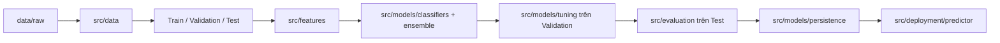

# Thiết kế dự án Spam Classifier theo 5W1H

Tài liệu này mô tả **thiết kế hiện có** của dự án và cấu trúc thư mục mục tiêu để người học, người bảo trì và người đánh giá biết mỗi thành phần thuộc đâu, đi qua luồng nào và được kiểm chứng ra sao. Nó không yêu cầu di chuyển hay tạo thêm module. Chi tiết thuật toán và số liệu của lần chạy tham chiếu nằm trong [Algorithms README](./README.md) và [README dự án](../../README.md).

## 1. What — Dự án giải quyết việc gì?

Đây là bài toán **binary text classification**: từ nội dung văn bản, dự đoán `ham = 0` hoặc `spam = 1`. Đầu vào thực nghiệm hiện tại là các tin nhắn ngắn trong `data/raw/spam.csv`; dự án chưa dùng metadata của email chuẩn như người gửi, tiêu đề hoặc HTML. Đầu ra của pipeline là nhãn dự đoán, điểm số Spam trong `[0, 1]`, các bảng/biểu đồ đánh giá và bundle để suy luận lại trên văn bản mới.

Phạm vi thuật toán gồm **Complement Naive Bayes làm baseline**, Logistic Regression, Linear SVM và Voting Ensemble để so sánh. Ba mô hình phân loại cốt lõi được tự cài đặt; điểm sigmoid của SVM và điểm Voting chưa được calibration nên không được hiểu trực tiếp là xác suất rủi ro thực tế.

## 2. Why — Vì sao thiết kế như vậy?

- **Baseline trước:** Complement Naive Bayes cho mốc đối chứng đơn giản, nhanh và dễ giải thích trước khi đánh giá các mô hình tối ưu lặp.
- **Đặc trưng thưa:** Word/bigram/character TF-IDF kết hợp keyword và numeric signals biểu diễn văn bản mà không cần mô hình ngôn ngữ lớn. Linear SVM và Logistic Regression phù hợp để thử trên ma trận thưa và có trọng số đặc trưng có thể phân tích.
- **Validation riêng:** Dùng Validation để chọn Top-K, hyperparameter, threshold và winner; Test chỉ đo hiệu năng sau khi chốt quyết định, nhằm tránh dùng cùng dữ liệu để chọn và báo cáo kết quả.
- **Ưu tiên Recall có giới hạn:** `RECALL_TARGET = 0.85` là mục tiêu thực nghiệm trên Validation. Accuracy, Precision, F1/F2, ROC-AUC, FPR và confusion matrix cho thấy chi phí chặn nhầm. Lần chạy tham chiếu của winner có Test FPR khoảng `40.05%`, nên kết quả hiện phù hợp cho học tập/cảnh báo hơn là tự động xóa thư.

## 3. Who — Ai sử dụng và chịu trách nhiệm?

| Vai trò | Nhu cầu chính | Nơi bắt đầu |
| :--- | :--- | :--- |
| Người học/đánh giá | Hiểu công thức, baseline, trade-offs và số liệu có nguồn | [Algorithms README](./README.md), các trang thuật toán trong thư mục này |
| Người phát triển pipeline | Thay đổi logic đúng module, kiểm tra luồng Train/Validation/Test | [`main.py`](../../main.py), [`src/`](../../src) |
| Người chạy thực nghiệm | Chạy lại pipeline, kiểm tra cấu hình và artifact | [README dự án](../../README.md), [`src/config.py`](../../src/config.py), [`results/`](../../results) |
| Người dùng suy luận | Nạp bundle đã lưu và dự đoán văn bản mới | [`src/deployment/predictor.py`](../../src/deployment/predictor.py) |

## 4. When — Thành phần được dùng ở giai đoạn nào?

1. **Chuẩn bị dữ liệu:** `loader.py` đọc và chuẩn hóa schema; `preprocessing.py` audit, làm sạch, chia phân tầng và chuẩn hóa văn bản.
2. **Fit trên Train:** `feature_engineering.py` học từ vựng, IDF, giới hạn độ dài, scaler và thứ tự cột; `classifiers.py` học tham số mô hình. Thông tin được fit không lấy từ Validation/Test.
3. **Chọn trên Validation:** Top-K, hyperparameter, threshold và winner được so sánh theo quy tắc Recall mục tiêu rồi Accuracy/F1. Voting là một ứng viên trong bước này.
4. **Đánh giá trên Test:** Tính metrics, vẽ biểu đồ và phân tích FP/FN bằng cấu hình/ngưỡng đã khóa. Không chọn lại mô hình theo Test.
5. **Suy luận:** `persistence.py` lưu/nạp bundle gồm model và phép biến đổi đã fit; `predictor.py` dùng lại bundle cho văn bản mới.

## 5. Where — Thành phần nằm ở đâu?

`main.py` là điểm điều phối bốn giai đoạn; `src/config.py` giữ cấu hình tập trung. Logic nghiệp vụ nằm trong `src/`, notebook phục vụ diễn giải/thực nghiệm, `tests/` kiểm tra hành vi, còn `results/` và `logs/` là đầu ra. Các trang trong `docs/Algorithms/` giải thích thuật toán, không là mã thực thi.

Ranh giới cần giữ: `data/` không huấn luyện model; `features/` không chọn winner; `models/` không dùng Test để tuning; `evaluation/` không fit lại phép biến đổi; `deployment/` dùng lại bundle và thứ tự cột đã lưu.

## 6. How — Pipeline hoạt động và được kiểm chứng thế nào?



`main.py` gọi lần lượt `step_data_preprocessing()`, `step_model_training()`, `step_evaluation_and_tuning()` và `step_deployment_and_demo()`. Chi tiết quy tắc chọn ngưỡng và winner có trong [Algorithms README](./README.md). Các kết quả định lượng trong tài liệu thuật toán là **ảnh chụp lần chạy tham chiếu**, không phải thuộc tính cố định của kiến trúc; khi đổi dữ liệu hoặc cấu hình cần tạo và kiểm tra artifact mới.

Kiểm chứng thiết kế bằng ba lớp: kiểm tra hành vi module trong `tests/`, kiểm tra tích hợp `main.py` và đối chiếu `results/metrics/` với cấu hình/split của cùng lần chạy. Không dùng kết quả Test để sửa ngưỡng rồi tiếp tục báo cáo trên chính Test đó.

## 7. Target project structure — Cấu trúc dự án mục tiêu

Cây dưới đây thể hiện **vị trí và trách nhiệm mong muốn trong cấu trúc hiện có**; các file sinh ra như CSV, biểu đồ, model và log có thể khác nhau giữa các lần chạy.

```text
spam_classifier/
├── AGENTS.md                         # Quy tắc cộng tác trong workspace
├── README.md                         # Tổng quan, chạy dự án, kết quả tham chiếu
├── requirements.txt                  # Dependency hiện có
├── main.py                           # Điều phối pipeline đầu cuối
├── .agents/                          # Rules và workflows của workspace
├── data/
│   ├── raw/                          # Dữ liệu đầu vào gốc
│   └── processed/                    # Dữ liệu và ma trận đã xử lý/cache
├── docs/
│   ├── Algorithms/                   # Giải thích mô hình và thiết kế dự án
│   │   ├── README.md                 # So sánh mô hình, quy tắc lựa chọn
│   │   ├── design.md                 # 5W1H và cấu trúc dự án
│   │   ├── naive_bayes.md            # Baseline và hai biến thể NB
│   │   ├── logistic_regression.md    # LR
│   │   ├── linear_svm.md             # Linear SVM
│   │   └── voting_ensemble.md        # Voting Ensemble
│   └── description_for_AI_working/   # Ghi chú kỹ thuật theo giai đoạn
├── notebooks/                        # EDA, features, baseline, tuning, deployment
│   └── results/                      # Artifact riêng của notebook
├── src/
│   ├── config.py                     # Đường dẫn và cấu hình thực nghiệm
│   ├── data/                         # loader.py, preprocessing.py
│   ├── features/                     # feature_engineering.py
│   ├── models/                       # classifiers.py, ensemble.py, tuning.py, persistence.py
│   ├── evaluation/                   # metrics.py, experiments.py, visualization.py, error_analysis.py
│   ├── deployment/                   # predictor.py
│   └── utils/                        # logger.py
├── tests/                             # Unit, regression và integration tests
├── results/                           # figures/, metrics/, saved_models/ của main.py
└── logs/                              # Log thực thi
```

**Nguyên tắc mở rộng:** Thêm logic vào module đang sở hữu trách nhiệm tương ứng. Nếu đề xuất thay đổi cấu trúc, luồng chọn model hoặc dependency, cần đánh giá tác động đến `main.py`, notebook, test và bundle suy luận trước khi triển khai. Cấu trúc mục tiêu trên không hàm ý đã có web UI, dịch vụ email thật hoặc xác suất đã calibration.
