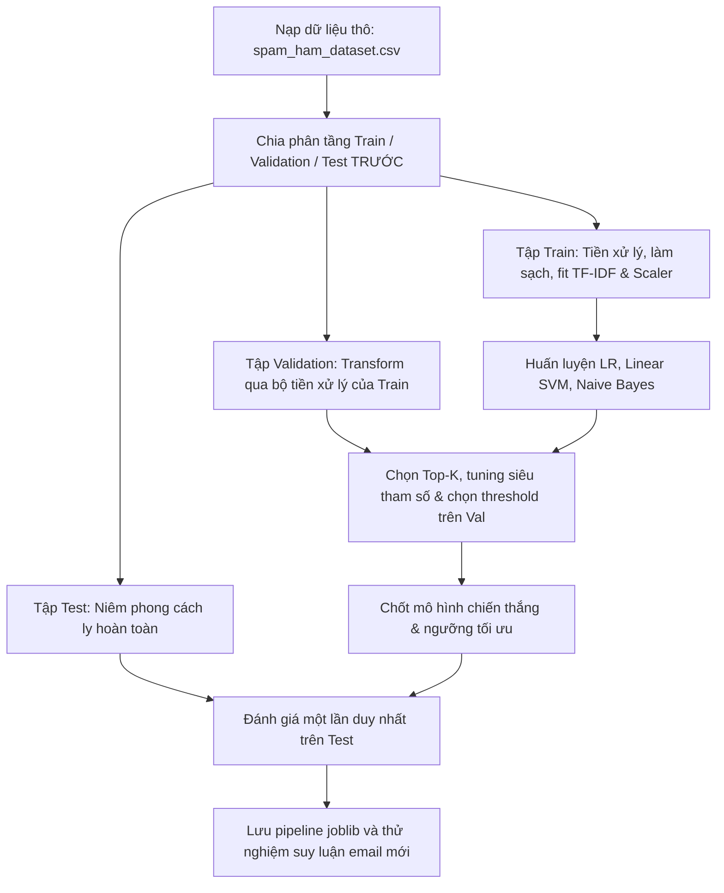

# Thiết kế bài lab Spam Classifier theo 5W1H

Trong bài lab này, nhóm dự kiến thực hiện bài toán phân loại email thành spam và ham. Mục tiêu chính là thực hành các bước của một bài toán Machine Learning chuẩn mực: chia dữ liệu độc lập trước, tiền xử lý và tạo đặc trưng trên tập Train, huấn luyện các mô hình from-scratch và đánh giá độc lập.

Tài liệu trình bày phương án thiết kế trước khi triển khai, gồm phạm vi, cách tổ chức công việc, phương pháp thử nghiệm và tiêu chí đánh giá. Nhóm sẽ thống nhất các lựa chọn này trước khi bắt đầu thực hành.

## 1. What 

### Bài toán và phạm vi

Nhóm chọn bài toán **phân loại văn bản nhị phân có giám sát**. Với nội dung một email, mô hình cần dự đoán một trong hai nhãn:

- `ham = 0`: email hợp lệ.
- `spam = 1`: email rác.

Dữ liệu đầu vào dự kiến là file CSV chứa nội dung email và nhãn ham/spam. Nhóm sẽ kiểm tra nguồn dữ liệu, phân bố nhãn và cấu trúc trường trước khi sử dụng. Việc đánh giá được giới hạn trong dataset của bài lab; khả năng áp dụng cho hộp thư thực tế cần được kiểm chứng riêng.

Phạm vi thực hiện gồm: chia tập dữ liệu phân tầng độc lập ngay từ đầu (Train/Test Split First), sau đó tiền xử lý và làm sạch trên tập Train, tạo đặc trưng số, huấn luyện các mô hình đơn giản, so sánh trên Validation, đánh giá độc lập trên Test và thử dự đoán email mới. Nhóm dự kiến thực hành trên máy cá nhân; việc kết nối với hộp thư thật nằm ngoài phạm vi bài lab.

### Dữ liệu đầu vào và kết quả đầu ra dự kiến

| Bước                        | Đầu vào                             | Đầu ra                                                                  |
| :---------------------------- | :------------------------------------- | :------------------------------------------------------------------------ |
| 1. Đọc và kiểm tra dữ liệu | File CSV có nội dung và nhãn       | Dữ liệu thô và mã bản ghi để đối chiếu        |
| 2. Chia tập độc lập ngay từ đầu (Early Split) | Dữ liệu thô đã đọc | Các tập Train, Validation và Test độc lập (Test được cách ly) |
| 3. Tiền xử lý & Tạo đặc trưng (chỉ fit trên Train) | Dữ liệu thô Train (Val/Test chỉ transform) | Ma trận đặc trưng số, bộ biến đổi đã fit và thống kê làm sạch |
| 4. Huấn luyện và lựa chọn   | Train và Validation                   | Mô hình cùng cấu hình và threshold được chọn                    |
| 5. Đánh giá kiểm toán độc lập | Mô hình đã chọn và Test          | Bảng metrics, confusion matrix và một số trường hợp dự đoán sai |
| 6. Chạy thử                    | Một văn bản mới                    | Nhãn dự đoán và score của mô hình                                 |
| 7. Lưu kết quả                | Mô hình và bộ biến đổi đã fit | File bundle để nạp lại và tiếp tục dự đoán                        |

## 2. Why 

Nhóm chọn đề tài phân loại spam vì bài toán có đầu vào và đầu ra rõ ràng, phù hợp để thực hành xử lý văn bản. Qua bài lab, nhóm muốn hiểu cách biến văn bản thành dữ liệu số và cách đánh giá mô hình ngoài việc chỉ nhìn vào Accuracy.

Nhóm dự kiến bắt đầu từ baseline đơn giản, sau đó mới thử các mô hình khác để có cơ sở so sánh.

| Lựa chọn dự kiến                               | Lý do chọn                                                                             | Hạn chế                                              |
| :------------------------------------------------- | :--------------------------------------------------------------------------------------- | :----------------------------------------------------- |
| Chia tập độc lập trước mọi bước tiền xử lý        | Tuân thủ nguyên tắc vàng của ML, chống rò rỉ dữ liệu (Data Leakage) từ Test sang Train | Cần quản lý chặt chẽ bộ biến đổi fit trên Train      |
| Word TF-IDF + Complement Naive Bayes làm baseline | Dễ triển khai, huấn luyện nhanh, phù hợp đặc trưng không âm                   | Khả năng thể hiện ngữ cảnh còn hạn chế        |
| Logistic Regression và Linear SVM                 | Phù hợp dữ liệu văn bản dạng ma trận thưa; có thể xem trọng số đặc trưng | Cần chọn tham số và kiểm tra quá trình hội tụ |
| Chia riêng Validation và Test                    | Có dữ liệu để chọn mô hình và dữ liệu để đánh giá cuối                  | Giảm số mẫu dành cho huấn luyện                  |
| Theo dõi cả Recall và Precision                 | Biết mô hình bỏ sót spam hay nhận nhầm ham ở mức nào                           | Cần cân nhắc sự đánh đổi giữa hai chỉ số    |
| Lưu mô hình cùng bộ biến đổi               | Dùng lại đúng cách tạo đặc trưng khi dự đoán                                 | Cần kiểm tra kết quả sau khi nạp lại             |

Nhóm ưu tiên những phương pháp có thể giải thích được qua cách biểu diễn văn bản, trọng số đặc trưng và các bước tính toán. Mỗi lựa chọn cần có lý do, cách đánh giá và giới hạn rõ ràng để các thành viên cùng hiểu và trình bày được.

## 3. Who

Bài lab chủ yếu phục vụ việc học và đánh giá môn học.

| Người tham gia       | Vai trò                                                                           |
| :--------------------- | :--------------------------------------------------------------------------------- |
| Nhóm sinh viên thực hiện | Phân công chuẩn bị dữ liệu, xây dựng thí nghiệm, đánh giá và tổng hợp báo cáo |
| Giảng viên           | Xem cách thiết kế, kiểm tra phương pháp và đánh giá báo cáo           |
| Người chạy demo     | Nhập văn bản mới và quan sát dự đoán                                      |

Nhóm sẽ phân công người phụ trách từng phần và một thành viên khác kiểm tra chéo. Các thành viên dùng chung dữ liệu, cách chia tập và biểu mẫu ghi nhận thí nghiệm để dễ tổng hợp. Nhóm cùng thống nhất metrics và quy tắc chọn mô hình trước khi huấn luyện so sánh; mỗi thành viên cần hiểu quy trình chung để giải thích phần việc của mình trong báo cáo.

## 4. When 

Nhóm dự kiến thực hiện theo từng bước, hoàn thành baseline trước khi thử cải tiến.

| Bước | Công việc                                                               | Kết quả cần có                                 |
| :----- | :------------------------------------------------------------------------ | :------------------------------------------------- |
| 1      | Xác định phạm vi, đầu vào, đầu ra và metrics                    | Phương án thiết kế cho bài lab               |
| 2      | Chia phân tầng Train, Validation, Test độc lập ngay từ đầu      | Dữ liệu thô được chia 3 tập, Test được cách ly |
| 3      | Tiền xử lý, làm sạch và tạo đặc trưng (fit trên Train, transform Val/Test) | Ma trận đặc trưng và bộ biến đổi đã fit |
| 4      | Huấn luyện baseline Naive Bayes và thử Logistic Regression, Linear SVM | Bảng so sánh các mô hình trên Validation |
| 5      | Dò tham số, tối ưu threshold trên Validation, sau đó đánh giá Test | Mô hình chiến thắng, kết quả Test và phân tích lỗi |
| 6      | Lưu mô hình, chạy demo và viết báo cáo                            | Chương trình có thể nạp lại để dự đoán |

Nếu kết quả Test chưa tốt, nhóm sẽ ghi rõ hạn chế trong báo cáo. Việc dùng kết quả đó để điều chỉnh mô hình sẽ cần một lần đánh giá độc lập mới.

## 5. Where 

Nhóm dự kiến thực hiện bài lab trên máy cá nhân, sử dụng cùng môi trường và bộ thư viện đã thống nhất. Tài liệu hướng dẫn sẽ ghi cách chuẩn bị môi trường để các thành viên có thể làm lại thí nghiệm.

Không gian làm việc dự kiến được chia theo trách nhiệm của từng bước:

| Vị trí                           | Nội dung chính                                          |
| :--------------------------------- | :-------------------------------------------------------- |
| `src/data/`                      | Đọc dữ liệu, chia tập phân tầng và tiền xử lý văn bản    |
| `src/features/`                  | Tạo và chọn đặc trưng; chỉ fit trên Train         |
| `src/models/`                    | Huấn luyện, tuning và lưu/nạp mô hình      |
| `src/evaluation/`                | Tính metrics, vẽ biểu đồ và phân tích lỗi        |
| `src/deployment/`                | Nạp mô hình để dự đoán văn bản mới             |
| `data/raw/`, `data/processed/` | Lưu dữ liệu gốc và dữ liệu sau xử lý             |
| `results/`, `logs/`            | Lưu bảng kết quả, biểu đồ, mô hình và log chạy |

## 6. How 

### 6.1. Luồng dữ liệu dự kiến



### 6.2. Dữ liệu và nguyên tắc chống leakage (Chia tập trước, Tiền xử lý sau)

1. **Nguyên tắc vàng của Machine Learning:** Luôn luôn chia dữ liệu (Train/Test Split) TRƯỚC, rồi mới tiến hành xử lý dữ liệu (Preprocessing). Việc này ngăn chặn rò rỉ dữ liệu (Data Leakage) từ tập Test sang tập Train.
2. **Nạp và xác thực dữ liệu thô:** Kiểm tra định dạng CSV, schema cột, encoding; giữ nguyên dữ liệu gốc để đối chiếu.
3. **Chia phân tầng độc lập ngay từ đầu (Early Stratified Split):** Chia tập **80% Train / 10% Validation / 10% Test**, **seed 42**, đảm bảo phân bổ nhãn đồng đều giữa các tập. Tập Test được niêm phong cách ly ngay tại bước này.
4. **Tiền xử lý chỉ fit trên Train:** Toàn bộ quá trình làm sạch (chuẩn hóa chữ thường, lọc stopwords, khử trùng lặp nội bộ, học ngưỡng cắt độ dài 791 từ, học từ vựng TF-IDF 3.000 từ, tính IDF, học tham số scaler) CHỈ ĐƯỢC HỌC (FIT) TRÊN TẬP TRAIN.
5. **Validation và Test chỉ Transform:** Tập Validation và Test được giữ ở dạng thô ban đầu, chỉ đi qua hàm `transform()` của bộ tiền xử lý đã fit từ Train; tuyệt đối không fit lại bất kỳ tham số nào.
6. **Thẩm định và đánh giá độc lập:** Dùng Validation chọn số đặc trưng Top-K, dò cấu hình và chọn threshold; giữ Test riêng biệt để đánh giá kiểm toán cuối cùng.

### 6.3. Chiến lược đặc trưng và mô hình

**Baseline dự kiến:** chuẩn hóa văn bản → word unigram TF-IDF → Complement Naive Bayes.

Baseline này đơn giản, huấn luyện nhanh và cần đặc trưng không âm. Nhóm sẽ kiểm tra từ mới, văn bản không còn token và độ ổn định khi tính xác suất nhỏ.

- So sánh **Logistic Regression** và **Linear SVM** trên cùng đặc trưng, cùng split.
- Thử từng nhóm đặc trưng bổ sung như bigram, character n-gram, độ dài hoặc từ khóa; giới hạn số cấu hình tuning và ghi nhận hội tụ.
- Nếu còn thời gian, thử **Voting Ensemble**; lựa chọn cuối dựa trên Validation.

### 6.4. Metrics và quy tắc lựa chọn trước training

Nhóm dự kiến theo dõi **Accuracy, Precision, Recall, F1/F2, FPR và confusion matrix** để thấy cả lỗi bỏ sót spam lẫn nhận nhầm ham. ROC-AUC, PR curve và thời gian thực hiện bổ sung góc nhìn về khả năng xếp hạng, threshold và chi phí.

**Chọn trên Validation:** ưu tiên ứng viên đạt `Recall >= 0.85`, rồi xét Accuracy → F1. Nếu chưa đạt mục tiêu, xét Recall → Accuracy → F1 và ghi rõ hạn chế. Nếu vẫn hòa, giữ ứng viên đứng trước theo thứ tự thử nghiệm đã thống nhất.

Mốc `0.85` là mục tiêu dự kiến, không bảo đảm đạt được; nhóm cần đọc cả Precision và FPR để đánh giá sự đánh đổi.

### 6.5. Kiểm thử và nghiệm thu dự kiến

- **Dữ liệu và chia tập:** số dòng được bảo toàn qua thống kê; cùng seed cho cùng split; nội dung trùng không xuất hiện ở nhiều tập.
- **Đặc trưng:** giữ số cột, thứ tự cột và bộ biến đổi đã học khi áp dụng cho Validation/Test.
- **Mô hình và metrics:** đối chiếu bằng ví dụ tính tay, kiểm tra mẫu số bằng 0 và hội tụ; thử toàn quy trình trên dữ liệu nhỏ trước.
- **Lưu/nạp:** cùng đầu vào cho cùng nhãn và score tương đương trong sai số số học.

Báo cáo dự kiến ghi cấu hình, seed, metrics và mẫu sai; phân biệt việc quy trình hoạt động đúng với việc đạt mục tiêu chất lượng.

### 6.6. Các trường hợp dễ gặp lỗi và giới hạn

Nhóm sẽ xem xét lỗi do email ngắn, từ mới, spam viết biến dạng hoặc ham chứa từ quảng cáo. Khi nhãn mất cân bằng, cần đọc nhiều metrics; khi tuning, cần giới hạn số lần thử để tránh quá khớp Validation.

Điểm SVM qua sigmoid chưa phải xác suất đã calibration. Kết luận chỉ giới hạn trong dữ liệu bài lab; email khác nguồn hoặc ngôn ngữ cần đánh giá riêng. Ví dụ trong báo cáo sẽ được loại thông tin cá nhân.

## 7. Cấu trúc dự án dự kiến

Nhóm dự kiến tổ chức các file như sau để dễ tìm và sử dụng lại từng phần. Các file sẽ được bổ sung theo nhu cầu thực hiện bài lab.

**Tiêu chí xây dựng thư mục:**

| Tiêu chí | Cách áp dụng dự kiến | Mục đích |
| :--- | :--- | :--- |
| Chia theo trách nhiệm | Mỗi thư mục phụ trách một công việc như dữ liệu, đặc trưng, mô hình hoặc đánh giá | Dễ phân công và kiểm tra chéo giữa các thành viên |
| Tách dữ liệu gốc và dữ liệu xử lý | Giữ nguyên dữ liệu trong `data/raw/`; lưu các bản dẫn xuất trong `data/processed/` | Có thể đối chiếu và thực hiện lại các bước xử lý |
| Phân biệt tài liệu, thử nghiệm và đầu ra | Dùng `docs/` cho thiết kế và giải thích; `notebooks/` cho khảo sát; `results/` cho đầu ra thí nghiệm | Tránh lẫn phương án dự kiến với kết quả thực nghiệm |
| Đặt tên rõ ràng và nhất quán | Tên ngắn, thể hiện nội dung; các file và thư mục Python mới dùng `snake_case` | Các thành viên dễ tìm đúng phần cần làm |
| Thuận tiện kiểm tra và tái lập | Tập trung phần kiểm tra trong `tests/`; lưu cấu hình, seed và thông tin lần thử cùng kết quả | Biết mỗi kết quả thuộc thí nghiệm nào và có thể làm lại |
| Hạn chế trùng lặp và ghi đè | Dùng chung phần xử lý cần tái sử dụng; phân biệt đầu ra của các lần thử bằng tên hoặc mã lần thử | Tránh mỗi thành viên dùng một cách xử lý khác nhau hoặc mất kết quả trước |
| Phù hợp quy mô bài lab | Chỉ thêm thư mục khi có trách nhiệm rõ ràng; tránh chia quá nhiều tầng cho một công việc nhỏ | Giữ cấu trúc dễ hiểu và vừa sức thực hiện |

```text
spam_classifier/
├── README.md                         # Giới thiệu và hướng dẫn chạy
├── requirements.txt                  # Các thư viện sử dụng
├── main.py                           # Chạy pipeline chính
├── data/
│   ├── raw/                          # Dữ liệu gốc
│   └── processed/                    # Dữ liệu sau xử lý
├── docs/
│   ├── reports/
│   │   └── spam_classifier_lab_report.html # Báo cáo kết quả bài lab
│   └── Algorithms/
│       ├── design.md                 # Thiết kế bài lab
│       ├── README.md                 # Giới thiệu tài liệu thuật toán
│       ├── naive_bayes.md            # Naive Bayes
│       ├── logistic_regression.md    # Logistic Regression
│       ├── linear_svm.md             # Linear SVM
│       └── voting_ensemble.md        # Thử nghiệm kết hợp mô hình
├── notebooks/                        # Khảo sát dữ liệu và trình bày thử nghiệm
├── src/
│   ├── config.py                     # Đường dẫn, seed và cấu hình
│   ├── data/
│   │   ├── loader.py                 # Đọc dữ liệu
│   │   └── preprocessing.py          # Chia tập và tiền xử lý văn bản
│   ├── features/
│   │   └── feature_engineering.py    # Tạo và chọn đặc trưng
│   ├── models/
│   │   ├── classifiers.py            # Các phương pháp phân loại
│   │   ├── tuning.py                 # Chọn cấu hình bằng Validation
│   │   ├── ensemble.py               # Kết hợp mô hình
│   │   └── persistence.py            # Lưu và nạp mô hình
│   ├── evaluation/
│   │   ├── metrics.py                # Tính chỉ số đánh giá
│   │   ├── experiments.py            # So sánh các thử nghiệm
│   │   ├── visualization.py          # Vẽ biểu đồ
│   │   └── error_analysis.py         # Xem các dự đoán sai
│   ├── deployment/
│   │   └── predictor.py              # Dự đoán văn bản mới
│   └── utils/
│       └── logger.py                 # Ghi log
├── tests/                            # Kiểm tra các phần chính
├── results/
│   ├── figures/                      # Biểu đồ
│   ├── metrics/                      # Bảng kết quả
│   └── saved_models/                 # Mô hình đã lưu
└── logs/                             # Log chạy chương trình
```
