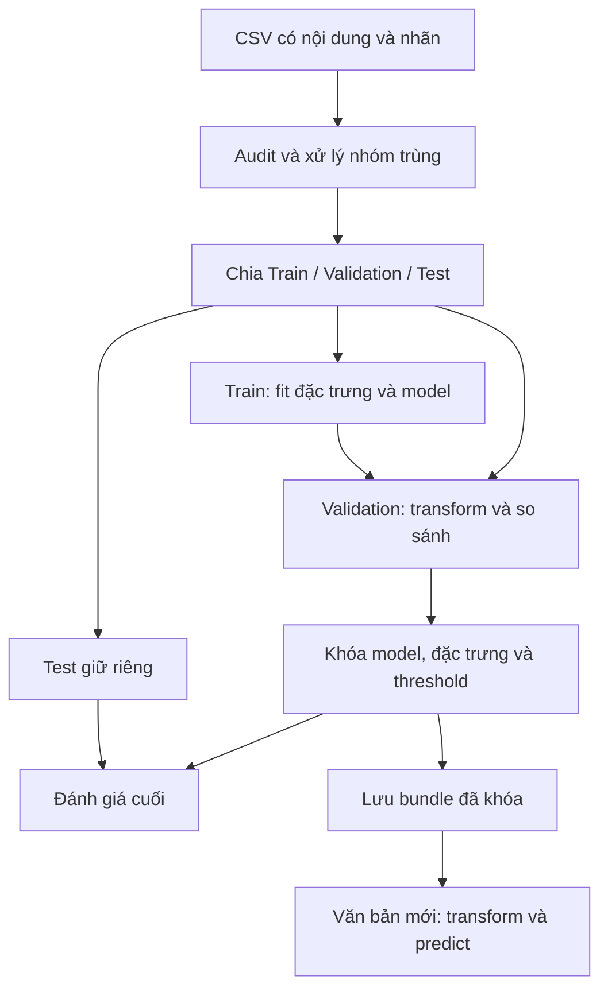

# Thiết kế Spam Classifier trước triển khai — 5W1H & Target Structure

**Trạng thái:** Bản thiết kế để định hướng xây dựng dự án từ đầu. Các module, cấu hình và luồng xử lý dưới đây là phương án dự kiến, không phải xác nhận đã cài đặt hoặc đã đạt kết quả thực nghiệm.

Tài liệu phục vụ người học, người phát triển và người đánh giá thống nhất phạm vi trước khi viết code. Baseline, tỷ lệ chia tập và Recall mục tiêu là lựa chọn thiết kế; không mặc định coi chúng là yêu cầu bắt buộc của đề bài nếu chưa đối chiếu tài liệu gốc.

## 1. What — Cần xây dựng hệ thống gì?

### Bài toán và phạm vi

Xây dựng hệ thống **supervised binary text classification**: từ nội dung văn bản, dự đoán `ham = 0` hoặc `spam = 1`. Dữ liệu dự kiến là CSV có nội dung và nhãn. Nếu dùng tập SMS, kết luận chỉ áp dụng trong phạm vi tin nhắn đó; khả năng phân loại email thực cần dữ liệu kiểm chứng phù hợp.

Phạm vi ban đầu gồm kiểm toán dữ liệu, tiền xử lý, trích xuất đặc trưng, baseline, so sánh mô hình, đánh giá và demo suy luận. Web UI, tích hợp hộp thư thật, tự động xóa email và phục vụ production nằm ngoài phạm vi ban đầu.

### Hợp đồng đầu vào / đầu ra dự kiến

| Thành phần | Đầu vào | Đầu ra / yêu cầu |
| :--- | :--- | :--- |
| Nạp và audit | CSV có nội dung và nhãn | Schema `source_id`, `raw_text`, `label`; báo rõ lỗi thiếu cột, nhãn không hợp lệ và nội dung rỗng |
| Làm sạch và chia tập | Bản ghi đã chuẩn hóa | Train/Validation/Test và báo cáo số lượng, lý do xử lý; đối chiếu được với nguồn |
| Đặc trưng | Văn bản và trạng thái fit trên Train | Ma trận thưa, cùng thứ tự cột trên mọi tập |
| Huấn luyện / lựa chọn | Train và Validation | Model, cấu hình đặc trưng, hyperparameter và threshold đã khóa |
| Đánh giá | Model đã khóa và Test giữ riêng | Metrics, confusion matrix, biểu đồ và phân tích FP/FN |
| Suy luận | Văn bản mới hoặc batch | Nhãn, score và threshold; đầu vào rỗng/không hợp lệ được từ chối rõ ràng |
| Lưu trữ | Model và các phép biến đổi đã fit | Bundle đủ để nạp lại và tái tạo dự đoán |

Score thể hiện mức độ model nghiêng về Spam. Nếu chuyển margin SVM qua sigmoid để đưa score về `[0, 1]`, không diễn giải đó là xác suất đã calibration.

## 2. Why — Vì sao chọn hướng thiết kế này?

Mục tiêu là hiểu toàn bộ vòng đời phân loại văn bản, tạo kết quả có thể tái lập và giải thích được lựa chọn. Thiết kế ưu tiên baseline đơn giản, module rõ trách nhiệm và đánh giá độc lập với bước tuning.

| Lựa chọn dự kiến | Lý do | Đánh đổi / giới hạn |
| :--- | :--- | :--- |
| Word TF-IDF + Complement Naive Bayes làm baseline | Chi phí thấp, phù hợp đặc trưng văn bản không âm | Giả định đơn giản, hạn chế về ngữ cảnh và tương tác giữa từ |
| Logistic Regression / Linear SVM sau baseline | Thử ranh giới tuyến tính trên ma trận thưa, có thể phân tích trọng số | Cần tuning, kiểm tra hội tụ; không bảo đảm tốt hơn baseline |
| Validation và Test riêng | Tách lựa chọn khỏi đánh giá cuối | Ít mẫu Train hơn; một split có thể chưa phản ánh độ ổn định |
| Ưu tiên Recall có kiểm soát | Giảm bỏ sót spam | Có thể tăng chặn nhầm ham; phải theo dõi Precision/FPR |
| Lưu cả phép biến đổi và model | Nhất quán giữa training và inference | Cần metadata và kiểm tra tương thích bundle |

Định hướng học tập là tự cài đặt các thành phần cốt lõi bằng Python và phép toán NumPy/SciPy. Đây là lựa chọn thiết kế, chưa được xác nhận là yêu cầu của PDF đề bài. Danh sách dependency cần được thống nhất trước khi bổ sung.

## 3. Who — Ai sử dụng và chịu trách nhiệm?

| Vai trò | Nhu cầu | Trách nhiệm dự kiến |
| :--- | :--- | :--- |
| Người học / phát triển | Hiểu và xây dựng pipeline | Xác định I/O, triển khai module, giải thích lựa chọn và viết kiểm thử |
| Người chạy thực nghiệm | So sánh phương án công bằng | Quản lý split, cấu hình, seed và artifact; không tuning trên Test |
| Người đánh giá | Kiểm tra tính đúng và bằng chứng | Đối chiếu thiết kế, metrics, phân tích lỗi và khả năng tái lập |
| Người chạy demo | Dự đoán văn bản mới | Cung cấp đầu vào hợp lệ, đọc nhãn/score cùng giới hạn của model |

Một người có thể đảm nhiệm nhiều vai trò. Metric chính, Recall mục tiêu và quy tắc lựa chọn phải được ghi lại trước khi huấn luyện để so sánh.

## 4. When — Triển khai theo thứ tự nào?

| Milestone | Công việc dự kiến | Đầu ra và điều kiện chuyển bước |
| :--- | :--- | :--- |
| 0. Chốt thiết kế | Thống nhất phạm vi, schema, metrics và chính sách dữ liệu | Cấu hình thực nghiệm và tiêu chí lựa chọn được duyệt trước training |
| 1. Audit và split | Kiểm tra rỗng, nhãn, trùng/mâu thuẫn; chia tập | Báo cáo audit; split tái lập; nhóm trùng không đi qua nhiều tập |
| 2. Baseline | Fit word TF-IDF và Complement Naive Bayes | Pipeline đầu cuối chạy được; có metrics và phân tích lỗi Validation |
| 3. Cải tiến | Thử LR/SVM, đặc trưng bổ sung và tuning giới hạn | So sánh cùng split/quy tắc; ghi rõ chi phí và thay đổi so với baseline |
| 4. Khóa và đánh giá | Chốt model/threshold bằng Validation, sau đó đánh giá Test | Báo cáo Test và giới hạn; không chọn lại theo Test |
| 5. Đóng gói và demo | Lưu/nạp pipeline, suy luận văn bản mới | Dự đoán nhất quán sau nạp lại; có hướng dẫn và artifact |

Nếu Test gợi ý thay đổi thiết kế, đó là một vòng nghiên cứu mới cần holdout mới hoặc kế hoạch đánh giá độc lập phù hợp. Không tiếp tục xem Test đã quan sát là bằng chứng chưa thiên lệch.

## 5. Where — Hệ thống chạy và các trách nhiệm nằm ở đâu?

Thiết kế ban đầu hướng tới batch và demo trên máy local. Script điều phối pipeline; notebook phục vụ EDA, giải thích và thử nghiệm. Không giả định cần GPU, cloud hoặc API production.

| Vị trí dự kiến | Trách nhiệm | Ranh giới |
| :--- | :--- | :--- |
| `src/data/` | Nạp, audit, làm sạch, chuẩn hóa văn bản, split | Không huấn luyện hoặc chọn model |
| `src/features/` | Fit/transform, scaler và lựa chọn đặc trưng | Thống kê học được chỉ fit trên Train |
| `src/models/` | Huấn luyện, tuning, ensemble tùy chọn, lưu/nạp | Không dùng Test để chọn cấu hình/threshold |
| `src/evaluation/` | Metrics, biểu đồ và phân tích lỗi | Không fit lại model/phép biến đổi |
| `src/deployment/` | Suy luận từ bundle | Giữ đúng schema và thứ tự cột |
| `data/raw/`, `data/processed/` | Dữ liệu nguồn và dữ liệu/cache trung gian | Giữ nguồn để đối chiếu, không sửa đè |
| `results/`, `logs/` | Artifact và trạng thái từng lần chạy | Tránh trộn lần chạy; không log toàn bộ văn bản nhạy cảm mặc định |

## 6. How — Xây dựng và kiểm chứng bằng cách nào?

### 6.1. Luồng dữ liệu dự kiến



### 6.2. Dữ liệu và chống leakage

1. Kiểm tra schema, encoding, nhãn, nội dung rỗng và bản ghi không hợp lệ; giữ `source_id` để đối chiếu.
2. Tạo khóa nhóm nội dung theo quy tắc cố định. Xử lý bản lặp/nhóm có nhãn mâu thuẫn **trước khi chia tập**; ghi số lượng và lý do, không tự gán nhãn theo dự đoán model.
3. Đề xuất chia phân tầng **80% Train / 10% Validation / 10% Test**, **seed 42**. Đây là cấu hình khởi đầu cần kiểm tra theo số mẫu mỗi lớp sau audit và chốt trước training, không phải tỷ lệ bắt buộc của đề bài.
4. Fit từ vựng, IDF, scaler, ngưỡng cắt độ dài và điểm chọn đặc trưng trên Train. Validation/Test chỉ `transform()` bằng trạng thái đó.
5. Chọn số đặc trưng, hyperparameter và threshold bằng Validation; giữ Test ngoài vòng lặp lựa chọn.
6. Lưu định danh dữ liệu/split và cấu hình. Nếu mẫu phụ thuộc theo nguồn, người gửi hoặc thời gian, cần cân nhắc split theo nhóm/thời gian trước thực nghiệm.

### 6.3. Chiến lược đặc trưng và mô hình

**Baseline đề xuất:** chuẩn hóa văn bản bằng quy tắc cố định → word unigram TF-IDF → Complement Naive Bayes. Bảo đảm đặc trưng không âm, xử lý token chưa gặp và vector rỗng, tránh lỗi số học khi tính log/xác suất.

Sau khi có baseline và phân tích lỗi Validation:

- Thử **Logistic Regression** và **Linear SVM** trên cùng đặc trưng/split để xác định ảnh hưởng của thuật toán.
- Thử riêng bigram, character n-gram, keyword hoặc numeric signals; dùng ablation để phân biệt tác dụng từng thay đổi.
- Giới hạn không gian tuning; ghi rõ cấu hình thất bại hoặc không hội tụ.
- Xem **Voting Ensemble** là mở rộng tùy chọn khi lỗi các model có tính bổ sung; so sánh lại chất lượng và chi phí, không mặc định tốt hơn model đơn.

Không chốt trước winner, số chiều cuối cùng, threshold hoặc hyperparameter tốt nhất. Những giá trị đó phải đến từ thực nghiệm trên dữ liệu phát triển.

### 6.4. Metrics và quy tắc lựa chọn trước training

| Metrics / bằng chứng | Mục đích |
| :--- | :--- |
| Recall | Đo tỷ lệ spam được phát hiện |
| Precision, FPR và số FP | Đánh giá chặn nhầm tin nhắn hợp lệ |
| F1, F2, Accuracy | Đánh giá tổng hợp; không chỉ dựa vào Accuracy |
| ROC-AUC và PR curve khi phù hợp | Đánh giá xếp hạng score ngoài một threshold |
| Confusion matrix và nhóm FP/FN | Xác định tình huống model thất bại |
| Thời gian fit/predict, kích thước đặc trưng/bundle | So sánh lợi ích với chi phí |

**Quy tắc đề xuất:** trên Validation, ưu tiên ứng viên đạt `Recall >= 0.85`; trong nhóm đó tối đa Accuracy, dùng F1 để phân xử. Nếu không ứng viên nào đạt, báo rõ chưa đạt mục tiêu và ưu tiên Recall rồi Accuracy/F1 để chọn ứng viên nghiên cứu tiếp. Cách xử lý hòa hoàn toàn cũng cần được chốt trước so sánh.

Mốc `0.85` là mục tiêu thực nghiệm đề xuất, không phải hiệu năng cam kết hoặc điều kiện đủ để tự động chặn thư. Luôn báo Precision/FPR; mức FPR có thể chấp nhận cho ứng dụng thực cần được xác định riêng với người dùng.

### 6.5. Kiểm thử và nghiệm thu dự kiến

- **Dữ liệu/split:** kiểm tra schema và các ca rỗng/trùng/mâu thuẫn; số dòng đối chiếu được; cùng seed tạo cùng split; nhóm trùng không giao nhau giữa tập.
- **Đặc trưng:** `transform()` không thay đổi từ vựng/IDF; giữ thứ tự cột; xử lý token mới, vector rỗng và ma trận thưa.
- **Mô hình/metrics:** dùng ví dụ nhỏ tính tay; kiểm tra gradient khi có tối ưu gradient, mẫu số bằng 0 và lỗi hội tụ.
- **Lựa chọn:** thay đổi nhãn Test không làm thay đổi model/threshold được chọn; mọi quyết định chỉ dựa trên Train/Validation.
- **Tích hợp:** pipeline chạy trên fixture nhỏ, tạo đủ artifact; nạp lại bundle cho cùng nhãn và score trong sai số số học cho phép.
- **Tái lập:** báo cáo gắn với cấu hình, seed, định danh dữ liệu/split và phiên bản mã nguồn.

Hoàn thành chức năng và đạt chất lượng mô hình là hai tiêu chí riêng. Chất lượng cần bằng chứng Test; nếu chưa đạt phải báo cáo trung thực, không sửa tiêu chí sau khi xem kết quả.

### 6.6. Failure modes và giới hạn

| Rủi ro | Cách đánh giá dự kiến |
| :--- | :--- |
| Spam viết né tránh hoặc dùng token mới | Phân nhóm lỗi Validation; thử character n-gram có đối chứng |
| Ham có từ quảng cáo bị chặn nhầm | Phân tích FP và trọng số đặc trưng; theo dõi Precision/FPR khi đổi threshold |
| Mất cân bằng lớp | Báo phân bố và metrics theo lớp; so sánh trọng số có kiểm soát |
| Khác miền/ngôn ngữ SMS và email | Kiểm tra tập ngoài phù hợp; không suy rộng khi thiếu dữ liệu |
| Overfit Validation do tuning nhiều lần | Giới hạn lượt thử, lưu lịch sử; cân nhắc cross-validation trên dữ liệu phát triển |
| Score bị hiểu nhầm là xác suất | Ghi loại score; chỉ kết luận calibration sau đánh giá tương ứng |
| Lộ nội dung nhạy cảm qua artifact | Giới hạn truy cập, ẩn thông tin cá nhân trước khi chia sẻ |

Nếu có metadata nhóm được thu thập hợp lệ và đủ mẫu, có thể kiểm tra chênh lệch lỗi giữa các nhóm. Không suy đoán thuộc tính nhân khẩu học từ văn bản; khi thiếu dữ liệu, ghi rõ giới hạn đánh giá.

## 7. Target Structure — Cấu trúc dự án mục tiêu

Cây dưới đây là **blueprint triển khai**, không xác nhận file đã tồn tại và không yêu cầu tạo mọi file ngay. Mỗi thành phần được triển khai theo milestone khi trách nhiệm tương ứng phát sinh.

```text
spam_classifier/
├── README.md                         # Mục tiêu, thiết lập, cách chạy, giới hạn
├── AGENTS.md                         # Quy tắc cộng tác
├── requirements.txt                  # Dependency được thống nhất
├── main.py                           # Điều phối pipeline
├── .agents/                          # Rules và workflows
├── data/
│   ├── raw/                          # Dữ liệu nguồn
│   └── processed/                    # Split và dữ liệu/ma trận trung gian
├── docs/
│   ├── Algorithms/
│   │   ├── design.md                 # Thiết kế trước triển khai
│   │   ├── README.md                 # Bản đồ tài liệu thuật toán
│   │   ├── naive_bayes.md            # Baseline
│   │   ├── logistic_regression.md    # Phương án LR
│   │   ├── linear_svm.md             # Phương án Linear SVM
│   │   └── voting_ensemble.md        # Mở rộng tùy chọn
│   └── description_for_AI_working/   # Đặc tả theo giai đoạn
├── notebooks/                        # EDA và giải thích thực nghiệm
│   └── results/                      # Artifact riêng của notebook
├── src/
│   ├── config.py                     # Đường dẫn, seed, cấu hình
│   ├── data/
│   │   ├── loader.py                 # Nạp dữ liệu, chuẩn hóa schema
│   │   └── preprocessing.py          # Audit, làm sạch, chuẩn hóa, split
│   ├── features/
│   │   └── feature_engineering.py    # Fit/transform, lựa chọn đặc trưng
│   ├── models/
│   │   ├── classifiers.py            # Baseline và mô hình đối chứng
│   │   ├── tuning.py                 # Lựa chọn trên Validation
│   │   ├── ensemble.py               # Voting khi cần thử nghiệm
│   │   └── persistence.py            # Lưu/nạp bundle, metadata
│   ├── evaluation/
│   │   ├── metrics.py                # Chỉ số đánh giá
│   │   ├── experiments.py            # So sánh và ablation
│   │   ├── visualization.py          # Biểu đồ
│   │   └── error_analysis.py         # Phân tích FP/FN
│   ├── deployment/
│   │   └── predictor.py              # Suy luận từ bundle
│   └── utils/
│       └── logger.py                 # Logging dùng chung
├── tests/                            # Kiểm thử hành vi và tích hợp
├── results/
│   ├── figures/                      # Biểu đồ theo lần chạy
│   ├── metrics/                      # Báo cáo/cấu hình theo lần chạy
│   └── saved_models/                 # Bundle cùng metadata
└── logs/                             # Log pipeline
```

Notebook nên gọi lại logic trong `src/` để giảm sai khác với pipeline chính. Bắt đầu bằng luồng baseline tối thiểu có thể kiểm chứng; đánh giá ranh giới module và hợp đồng I/O trước khi mở rộng cấu trúc.
